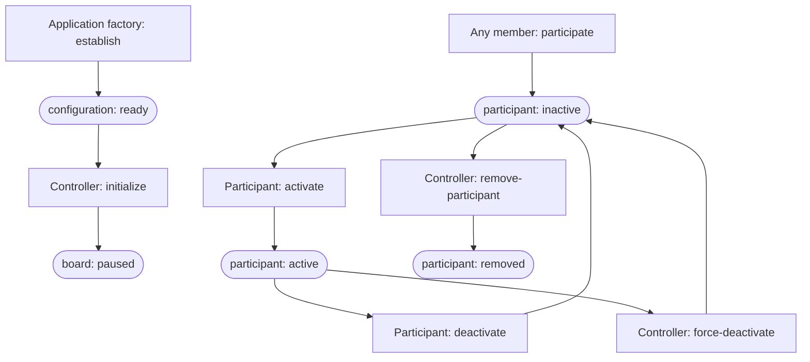
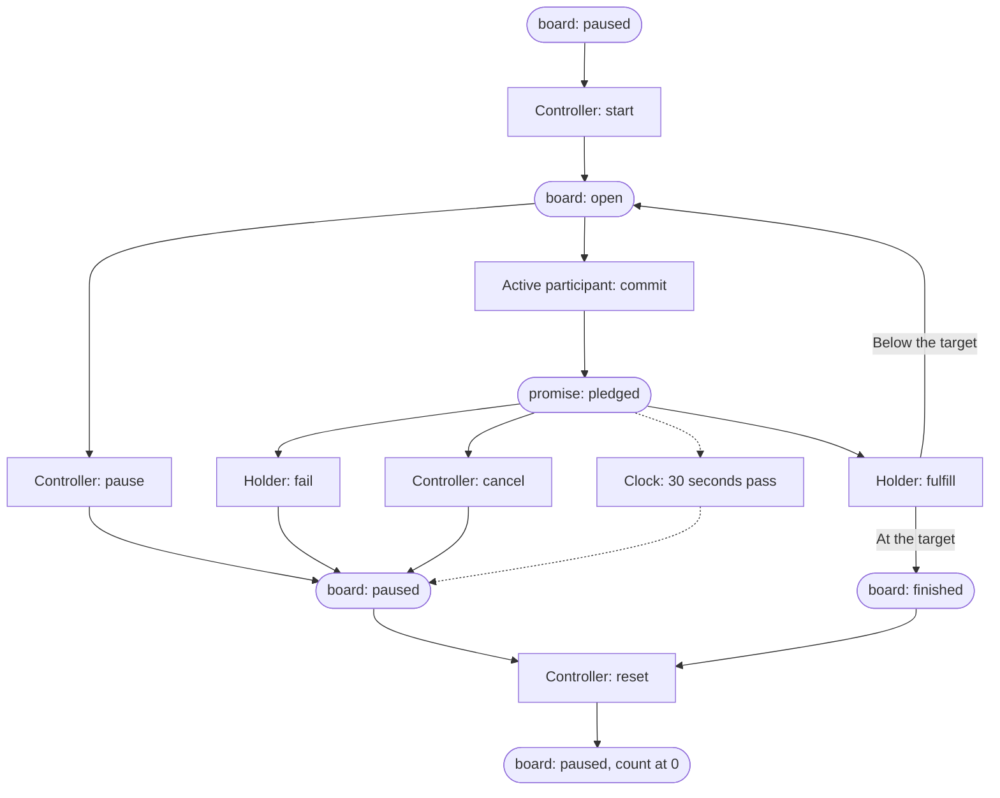

# The Counter

The Counter, dap-counter, is an application built on dap. People and
agents take part in a shared count. A participant commits to say the next
number, says it aloud, and reports that they said it. A dap scope judges
every act against the Counter's definition, so the count holds whatever a
client does. The framework is described in
[What is dap?](../../docs/what-is-dap.md) and
[The architecture of a dap application](../../docs/architecture.md).

This page describes the definition `counting-commitments`, declared in
[commitments.ts](commitments.ts). The Counter page in [browser](browser)
runs it, and `dap install --cohort counting-commitments` installs its
cohort.
[Taking part in a Counter](../../docs/mcp.md#taking-part-in-a-counter)
shows an agent taking part through MCP tools. An earlier definition,
`counting`, is also kept here; see
[The first definition](#the-first-definition).

## Build and deployment ownership

The Counter's browser source, build script and generated assets live here.
From the repository root, `node apps/counter/scripts/assets.mjs` builds its
three public assets and the module served by the application Worker.

Counter shares Room's existing `artroom-scope` Worker. Its deployment
configuration is [Room's wrangler.jsonc](../room/wrangler.jsonc), and its
route is included by [Room's application dispatch](../room/fetch.ts).
There is no independent Counter Worker. A shared Worker deployment also
publishes Room and the other routes it owns. This consolidation changes no
Worker name or served URL and runs no deployment. Hugh's current hold
prohibits Cloudflare infrastructure deployments until further notice.

## Items

The scope holds four types of item:

| Item | How many | States | What it holds |
| --- | --- | --- | --- |
| `configuration` | One | `ready` | The controller and the target, from 1 to 100. Neither can change. |
| `board` | One | `paused`, `open`, `finished` | The last fulfilled number, the last speaker, the generation and serial, and a link to the pledged promise. |
| `participant` | Up to 16 that are not removed | `inactive`, `active`, `removed` | The member who takes part. |
| `promise` | One pledged at a time | `pledged`, then `fulfilled`, `failed`, `cancelled` or `expired` | The holder, the number, the active participants at the time, and a deadline 30 seconds after the commitment. |

## Who can attempt each act

The application factory writes the first act, and three kinds of
participant sign the rest:

- The **application factory** writes the genesis act, `establish`, when
  a member who holds `application.establish` creates the scope. It names
  that member as the **opener**, who becomes the **controller**. No
  participant signs `establish`.
- The controller runs the board and manages participants.
- Any **member** can become a **participant**, and a participant chooses
  when they are active.
- The **holder** is the active participant whose commitment the scope
  accepted.

In the two diagrams, a box is an act, labelled with who may sign it. A
rounded shape is an item in a state. An arrow into an act shows the state
that the act needs. The scope refuses any other attempt.

### Setting up the scope and its participants



- A member can hold one participant item that is inactive or active.
- The controller can force-deactivate another participant, but not
  themselves.
- A removed item is final. That member can participate again, which
  opens a new item.
- A participant who holds a pledged promise cannot be deactivated or
  removed.

### Taking turns



- Start needs a count below the target. It opens the board to
  commitments and does not choose a speaker.
- Any active participant can commit while the board is open and no
  promise is pledged. If several try, the scope accepts one commitment
  and refuses the others.
- When more than one participant is active, the last speaker cannot
  commit next.
- Fulfill must take effect before the promise's deadline. It moves the
  count to the promised number.
- Fail and cancel pause the board and leave the count where it was.
- After 30 seconds the clock pauses the board and expires the promise.
  No participant signs that step.
- From a paused board the controller can start again or reset. Reset
  begins a new generation with the count at 0, and keeps the participants
  and the journal.
- Start, pause and reset are refused while a promise is pledged.

## Grants

Each act needs a grant, which the membership's policy gives to roles.
Creating the application grants nothing by implication. The guards above
apply as well: holding `counting.control` is not enough to start the
board, because start also requires the controller's signature.

| Grant | Acts |
| --- | --- |
| `counting.establish` | `establish` |
| `counting.control` | `initialize`, `start`, `pause`, `reset`, `cancel`, `force-deactivate`, `remove-participant` |
| `counting.participate` | `participate` |
| `counting.activity` | `activate`, `deactivate` |
| `counting.commit` | `commit` |
| `counting.fulfill` | `fulfill` |
| `counting.fail` | `fail` |

## What the scope checks

A client proposes values, and the scope checks every one before it copies
any of them:

- A commitment carries the board's generation, the next serial, the next
  number, and the complete list of active participants in the order they
  first took part. The scope checks each against its own state.
- Fulfill, fail and cancel carry the promise's generation, serial and
  number. They take effect only on the promise that the board links to.
- Reset carries the next generation, so a report from before a reset no
  longer matches.

The definition uses the common declaration forms and four named rules. It
sends nothing, receives nothing, declares no capabilities and creates no
other definitions.

## Files

| File | What it is |
| --- | --- |
| [commitments.ts](commitments.ts) | The `counting-commitments` definition. |
| [commitments.json](commitments.json), [commitments-pin.ts](commitments-pin.ts) | Its canonical bytes and its digest. |
| [commitments.test.ts](commitments.test.ts) | Four tests of the definition in a scope held in memory. |
| [commitments-README.md](commitments-README.md) | The source record for the definition, with its evidence and limits. |
| [browser](browser) | The Counter page. [browser/startup.md](browser/startup.md) covers its setup, device keys and speech. |
| [definition.ts](definition.ts), [definition.json](definition.json), [pin.ts](pin.ts), [definition.test.ts](definition.test.ts) | The first definition, `counting`. |
| [definition-README.md](definition-README.md) | The source record for the first definition. |

## Run the tests

From the repository root, with dependencies installed:

```sh
node node_modules/vitest/vitest.mjs run --project counting
node node_modules/typescript/bin/tsc -p apps/counter/tsconfig.json
```

The first command runs both definitions' tests: eight tests in two files.
They use the real validator, rule evaluator, judgment, sealing and fold,
with grants and a clock that the test scripts. They do not establish
stored state, restart, membership authority or audible speech.
[packages/scope/test/counting-commitments.test.ts](../../packages/scope/test/counting-commitments.test.ts)
runs the definition in a native scope.

## The first definition

[definition.ts](definition.ts) declares `counting`, the first Counter
definition. It has no promises. The controller's `start` gives the turn
to one participant, and that participant's `spoken` reports the number
and passes the turn to the next participant in join order. It also has
`join`, `leave`, `cancel-turn`, `pause`, `reset`, and a 15-second turn.
No scope moves from one definition to the other.

[Build a counter](../../docs/build-a-counter.md) is a tutorial that builds
a smaller version of this first definition. Its source record is
[definition-README.md](definition-README.md).
