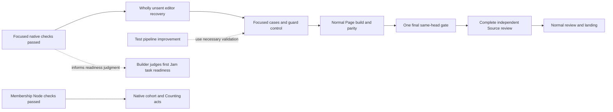

# Hourly sprint survey — 9 October 2026, 21:07 Eastern

Snapshot refreshed at 2026-10-10 01:07 UTC. Workroom survey and retained evidence; no new gate or runtime executed by the planner.

The initial code candidate has passed its focused native repair checks. A newly identified editor recovery gap is being fixed before another full gate. Membership's new cohort has passed its focused Node checks; its native acceptance remains open. UX checks found inadequate DOM stand-ins, which now have a separate repair ready for focused validation.

| Work | Evidence and current state | Next action / owner |
|---|---|---|
| Initial Artroom delivery | At `cfe91598`, four compilers, six compatibility cases and seven original native cases passed. SQL-fault and hash-mismatch diagnostics remain visible. | Builder completes the editor repair, generated Page build and final candidate; checker continues complete Source review. |
| Editor recovery | Checker `80806d57` found a wholly unsent task could become stuck. Source `df1b3787` restores an explicit, guarded Back to edit path. No checks have run on it yet. | Builder runs the meaningful mounted cases and one focused guard control, then prepares the exact gate subject. Unknown and partial originals stay intact. |
| Test overhead | Request `67a93589` is promised. The recorded native phase interval was 254.252 seconds; eight separately timed commands sum to 16.242 seconds. The difference includes unmeasured guards, reporting and coordination. | Builder makes a single guarded fail-stop pipeline with structured coverage and fewer phase handoffs. Use necessary editor validation; avoid a new benchmark suite. |
| UX | At `c292f670`, the affected compiler passed and 40 cases were collected. The body reported 38 passes, one Actions DOM failure and one case unexecuted after bail. The prior seven Join errors are gone. An isolated setter correction is next; production checks and all 40 assertions remain. | Builder runs the affected test compiler and complete 40-case selection once. Real browser, native authority and accessibility proof remain owed. |
| Membership cohort | At `2961d8c0`, three compilers and five Node cases passed. The two new pins came from actual generation at `f1455d94`. | Builder prepares real R6/D6/M5 creation, admission, expiry, reservations, sessions and grants using existing native infrastructure. |
| Invitations and continuity | The shared codec has a v2 ceiling repair. I2's independent bootstrap, no-redirect transport and single enrollment journal have a staged source plan. Current Page Join is still memory-only. | Builder completes the shared codec witness and bootstrap/transport source, then durable original-envelope custody. |
| Jam | Its symbolic demo exists at `990dcbf3`. The builder's concrete readiness judgment under `b4ef9b7a` is still owed. | Judge the first own-act-model task now; name any actual blocking capability and owner. Completion of the whole backlog is not a prerequisite. |
| Documentation and planning | Main `18a1288d` contains the five reviewed manual corrections. Volatile-language and webhook design notes are already published under their full-scope delegations; duplicate original request rows need reconciliation. | Keep docs moving in parallel. Webhook runtime remains unprioritized; published design is not runtime delivery. |

The native selections establish their own boundaries, not a full gate, timeout cause, physical draining, deployment or whole product result. The project-wide 10× test-cost target is not yet proved. Separate command sums are not one observed pipeline duration. Test deletion still needs an invariant and its surviving witness.

The full browser coding experience remains the product goal: real repository work survives interruption; a person can watch, steer and review from another authorized device; recorded outcomes govern completion. Full I3/IA workspace and publication, C4/I5/I6 browser/device continuity, capacity, retained evidence and replay, public starter and package distribution, the complete manual, hosted Counting and actual audio remain open. The Oct 14 demo deadline and conditional Oct 10–12 preparation targets remain in force.

No current implementation choice requires Hugh's decision. Bring actual hosting, cold-person and listening assessment when there is a concrete candidate. The next sprint preparation is 22:35 Eastern and the boundary report is 23:00 Eastern.
