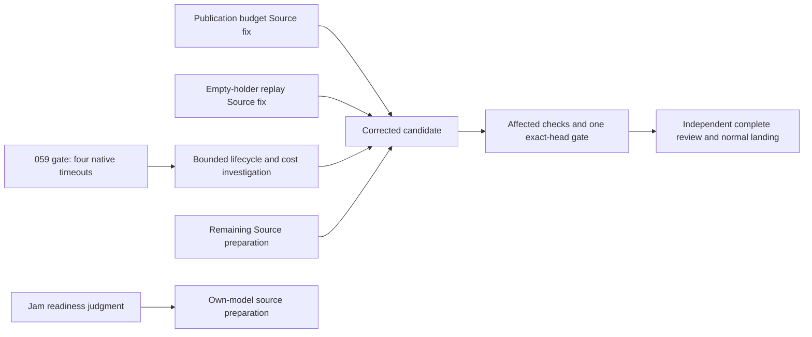

# Hourly sprint survey — 9 October 2026, 22:07 Eastern

Snapshot refreshed at 2026-10-10 02:07 UTC. Workroom and retained public evidence; no runtime executed by the planner.

The focused editor and UX work now passes its selected checks. The full initial gate still fails: 1,001 cases passed, four native cases timed out at their original five-second limit, and two recorder cases skipped. The test phase took 320 seconds. Publication is held for those failures and two source-review findings; another unchanged whole-suite run is not authorized.

| Work | Verified state | Next action / owner |
|---|---|---|
| Initial delivery | Frozen `059853a2`, 224 actual changed paths. Typecheck passed; full gate ended with four native timeouts. Active-source continuation did not run. | Builder maps the failing operations and smallest useful diagnostic cohort. Checker batches remaining Source findings before the next candidate gate. |
| Editor recovery | At `0dd52d2b`, two compiler contexts and all three existing cases passed. Both targeted controls fail their intended assertions when a guard is removed; the baseline was reused. Normal Page build and exact `059` parity passed. | Preserve evidence and source. Include corrected publication/replay work in the next exact reviewed candidate; no acknowledgment-triggered repeat. |
| Test economy | The new guarded pipeline ran the necessary editor checks in one outer invocation: 1.74 elapsed / 3.07 CPU seconds, without separate discovery or intermediate handshakes. | The full 10× goal remains open. Highest-priority `e1580252` addresses four native failures and the dominant full-suite cost while retaining useful invariants and deadlines. |
| Publication | Checker found obsolete intermediate trees are retained/sent, consuming the allowance before final reachable closure is considered; sender copies before aggregate checking. | Builder `564d5fc9`, promise `ac23ad39`: bounded final affected-tree construction and pre-copy budget check, preserving all 64 edits and Git/authority/custody semantics. |
| Replay | A valid empty holders answer is reconstructed with an invalid zero request bound, making unanchored replay disagree. | Builder `3024ef22`, promise `b97d5c30`: positive equivalent bound and one meaningful actual retained-negative-fact replay witness. No anchors or grants inferred from absence. |
| UX | At `26325475`, all 40 cases passed, including the mounted dialog journey. This is scripted DOM/data evidence. | Complete UX request stays separate from initial `059`. Deliberately carry the common editor patch; rendered browser, native authority, device and accessibility acceptance remain owed. |
| Counting and invitations | M1 three compilers/five Node cases passed; native capacity/session/grant acceptance remains open. I1 ceiling source and legacy compatibility mapping progress; I2 staged bootstrap/transport/journal remains source work. | Reuse existing real-native fixtures and the shared codec/custody owner. Do not replace the full hosted/voice/device stories with parser or model tests. |
| Jam | Builder judged the first own-model source task ready enough. `c4df615a` is promised under `b0321713`: contribution declaration, lossless integer codec and recorded-v1 scheduling reducer using original fixtures. | Proceed alongside backlog/docs. Public package/validator, F1 establishment, deployment/grants and actual hosted music/listening remain distinct dependencies. |
| Documentation / public delivery | Main remains `18a1288d` with reviewed manual corrections. Existing volatile/webhook design notes are published. N3 remains a design commission; it is not actual registry publication authorization. | Keep the full manual moving. Map the real coordinated public release owner/candidate; first Jam source does not wait for the complete cold-user starter. |

The failed gate measured 325.935 elapsed / 382.97 CPU seconds; its test command measured 320.10 / 364.47. These are actual boundaries, not inflated reporter phase totals. The 1.74-second editor pipeline is a different selected cohort and proves no like-for-like full-suite factor. Retained timeout-abort, deliberate SQL-fault and content-type diagnostics do not identify the timeout cause. No widening, hidden skip, replacement fake, warm-up loop or mutation sweep is proposed.

The checker reports two whole Source readers still in progress, with latest sealed totals 350/390 and 308/390 authored units. The current two established blockers are publication capacity and empty-holder replay; no new blocker has been established from the qualified install-fixture concerns. Formal final Source/evidence review and landing remain unfulfilled.

Full scope remains: real coding work survives interruption and reaches recorded review/publication; another authorized device observes, steers and reviews it; capacity, retained evidence and replay are correct; public packages and starter work from their actual supported boundaries; the complete manual, hosted Counting and real audio/provider/browser/device acceptance must be delivered. Existing I3/IA/C4/I5/I6 and C1/M1/I1/I2/A1/R1/S1/V1 obligations remain with their owners. Neither a model statement nor a selected passing test records a product outcome.

No current decision is waiting on Hugh. Sprint preparation is at 22:35 Eastern and the boundary report at 23:00 Eastern. Keep those reports readable and separate actual results from planned work.

