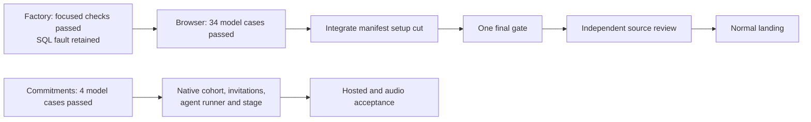

# Hourly sprint survey — 9 October 2026, 19:07 Eastern

Evidence refreshed at 2026-10-09 23:08:47 UTC. Planner owns this survey; builder owns source and runtime delivery; checker owns independent review.

The initial factory/observer/browser integration is ready to advance to its final candidate gate. Commitment-based Counting has a validated declaration and four passing model cases. The full hosted coding journey, cross-device continuity and refined Counting demonstration remain open.

## Progress this hour

| Work | Observed result | Next action |
|---|---|---|
| Generic application factory and legacy Counting | At bb5bf627, all thirteen selected pure cases and the original native establishment case passed. The native raw log still prints the SQL fixture retention fault; this is a qualified pass. | Carry the full evidence into the initial integrated candidate and independent source review. |
| Browser recovery and steering | At e5cb5203, compiler, bundle and exact three-entrypoint preflight passed; all 34 Node cases passed. Both malformed-custody failures from the previous head were repaired without weakening their assertions. | Integrate the ready manifest setup cut, then run the affected checks and one final gate. This remains fake service/DOM/memory/speech evidence. |
| Commitment-based Counting | At 2c7a650b, all four actual grammar/canonical-pin/model cases passed. Checker confirmed source and retained evidence correspondence. | M1 may consume the exact validated declaration/pin. Native contention, capacity/exhaustion, enrollment, recovery and audio proof remain. |
| Test economy | Complete manifest and Site-route audits found useful setup and transport reductions while retaining the functional cases. Manifest change b0727da0 is authored; Site transport work is assigned. | Verify three affected manifest cases once. Make Site's scripted transport honor actual wants instead of decoding unrelated megabyte blobs. |
| UX | Builder reports a separate clean source candidate 703a7f83 based on the critical branch; its packet is being frozen. | Review its actual delta and evidence next. It does not hold the initial candidate gate. |
| Documentation | Six manual draft pages plus ledger/index already have bounded independent source approval and publication. Their status text needs to catch up. | Small docs-only maintenance assigned; full 67-page manual and all eight acceptance conditions remain open. |

## Owners and immediate priorities

Builder: finish the initial e5cb + b072 composition, exact three-case manifest verification and one gate under planner handoff 21065b2a. Preserve current main report/manual bytes, original critical/factory/observer/Counting source and lock identity. Do not wait for separate UX, M1, Site or permanent-coverage branches. Stop and disposition any failure; no unchanged gate retry.

Checker: the complete live-interface Draft3 review is accepted under a1362e2c / afb974fb after the completed commitment preparation. Full exact-head source review of the initial candidate follows its gate. Earlier preparation and isolated passes are not final approval.

Parallel source work: M1 keeps the explicit bounded Counting cohort and original install-plan custody; I1 preparation reuses current CLI/Page/parser/enrollment owners; UX keeps the selected retained-source editing path and shared-name decision. Later invitation, enrollment, Application facade, independent speech adapters, dynamic stage and real acceptance keep their original eight tasks and full scope.

Test economy remains highest priority. The manifest audit removes eight unused CLI setup calls across two admission cases and six unused legacy membership operations. The Site audit identifies unnecessary object decoding; its claimed benefit is still a source hypothesis. There is no measured tenfold full-workflow saving. No functional test deletion was justified in these two complete audits.

## Full product and demo scope

The person-starts-coding-in-a-browser, closes-the-laptop, resumes-on-another-device experience remains owed. Real dirty repository state, command/results/process uncertainty, prepared Git closure, fork/hold/credentials, interruption recovery, owner/private authorization, same-member device enrollment/revocation and actual qualified review/publication require their own integrated evidence. Counting or model fixtures do not satisfy those stories.

Jam's current checkout is clean at 990dcbf3 and contains reviewed symbolic procedural demo source. Its README still describes the project as unbuilt. Builder's existing readiness judgment has been followed up: choose the concrete next Jam task or name the actual missing capability and owner. Public package/deployed-room use, native attachment, current listening and musical acceptance remain distinct. The builder judges readiness; unrelated backlog completion is not a first-Jam gate.

The initial source integration is not the completed refined Counting demo. The committed-pledge contract, member/key limits, named invitations, independent logical agents/voices, dynamic roster and actual hosted/native/audio acceptance remain required. The 14 October demonstration deadline and conditional 10 October candidate, 11 October freeze and 12 October recording targets remain planning targets, not guarantees.

Full capacity accounting, all recovery mappings, complete manual, public-package/cold-agent support, security and host/provider acceptance remain with their existing owners. Stale-worktree cleanup preserves active source/evidence worktrees; the prior metadata cleanup is not a claim that all remaining worktrees can be removed.

## Decisions and cadence

No Hugh decision is needed for the current source/check/review steps. Later documentation-host/cold-person choices and Jam's worth-hearing assessment remain recorded future needs, to be presented with a concrete candidate.

Next hourly survey: 20:07 Eastern / 00:07 UTC on 10 October.
Sprint-boundary preparation: 22:35 Eastern / 02:35 UTC.
Boundary and readable sprint report: 23:00 Eastern / 03:00 UTC.

## Evidence references

- Factory result fe035a6f: /tmp/artroom-f1-bb5-runtime-result/complete-result.json and both discovery/body logs. Pure body 0.819 s wall / 1.819 s CPU; native body 2.686 s / 3.280 s, qualified.
- Browser result aab3704b: /tmp/artroom-u1-e5cb-supplemental/complete-result.json and raw 34-case log. Node body 1.750 s wall / 2.534 s CPU.
- Commitment result 90addff8, correspondence c0857e29: /tmp/artroom-c1-2c7a-body/complete-result.json. Body 0.716 s wall / 0.898 s CPU.
- Manifest audit bbb2e508 / implementation f1fde53b; Site audit 0bea2677 / implementation aadee9b4.
- Manual approval fc4e18d5, publication 25467a36, maintenance 581aa3e3.

These are separate observed commands at distinct exact subjects, not a summed pipeline duration or a new whole-gate result. Root read the actual listed results/logs and bounded source dispositions; no Root project tests, provider, browser, audio or deployment ran. This survey is workroom evidence, not the normal Git publication of the later sprint report.
