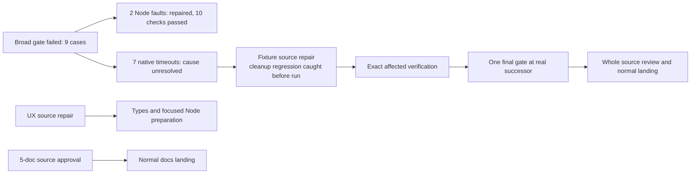

# Hourly sprint survey — 9 October 2026, 20:07 Eastern

Evidence refreshed at 2026-10-10 00:07:54 UTC. The initial code increment remains blocked on seven native test failures. Its two determinate Node failures have been repaired and verified. Builder is correcting native fixture ownership and cleanup; checker has begun full source preparation. No new broad gate is running.

## Results and work in flight

| Work | Actual state | Next step |
|---|---|---|
| Initial broad gate | d048 type checking passed. The gate finished with 996 passes, 9 failures and 2 existing recorder skips; seven failures were original five-second native timeouts. Active-source checks did not run. | Preserve this result; do not repeat the unchanged gate. Finish the source and affected-check disposition for every failure. |
| Asset and version assertion repairs | ab9's exact two-file selection passed all 10 cases. The normal Page build regenerated assets, and the old unsupported rules@3 lookup now names genuinely unsupported rules@4. | Keep these verified fixes in the eventual successor. The native failures are still open. |
| Native fixture repairs | First frozen source 287777fa changes 13 paths relative to ab9 and 222 paths relative to current main. Preparation caught a cleanup regression before execution; a corrected successor is being authored. | Verify idempotent identity-only teardown after release and safe predecessor handling, then review the frozen seven-case plan. |
| UX | b615f6b8 repairs retained-dialog updates, accepted-comment text restoration, stale review qualification and select-choice restoration. Root read all six repair deltas and matched all 16 cumulative source hashes. | Three Page compiler closures and a meaningful Node selection preparation are released. No actual UX type/test/browser result is yet received. |
| Counting cohort | f145 source, declaration-generation plan and recipes are ready; one guarded local validation/generation step is released. | Produce actual D6/M5 canonical digests and bind only those two new entries while preserving the complete version witness. No generated result is yet received. |
| Invitation and shared runner | I1/A1 source maps are complete. One shared pure bounded codec is released for authoring. | Reconcile I2's trusted bootstrap, no-redirect transport and durable Join journal. The current Page Join journal is in memory; current U1 is still the legacy speech-before-report model. |
| Documentation | The exact five-document maintenance leaf 128a has normal independent accuracy/plain-English approval. Main was last verified clean at 8479057c. | Builder ratifies its owned review, lands and pushes normally, then returns a verified receipt. No code gate is required for this docs-only leaf. |

## Native correctness and test economy

All seven native cases remain required: CLI story, native version-3 Site publication, retained Page source preview, application establishment, real founding, immutable Site publication and legacy version founding. Their original titles, assertions, routes, pins, refusal/recovery/replay controls and five-second deadlines are preserved. The broad log does not identify the exact operation where each timed out.

The selected source repair removes proven unused demo enrollment and issue setup, restores each deliberate SQL corruption control to its exact captured state/record, and adapts older continuations to the existing owned fixture and bounded driver. Dispatch-only phases must remain dispatch-only. Cleanup must not revive retired owners or replace newer installations. Neither a source map nor a later fresh pass establishes original timeout cause, physical cancellation, draining or long-pool behavior.

The full failed d048 gate took 350.648 seconds wall and 408.262 seconds CPU. The isolated Node repair run took 0.726 seconds wall and 1.228 seconds CPU. These have different scopes and cannot be divided into a savings claim. The requested tenfold full-workflow reduction remains unproven.

The Site fixture source c058f186 sends exact packetized wanted objects instead of unrelated megabyte blobs. Its fifteen functional cases and actual wire/hash/token/byte-limit checks remain; scoped verification is still owed. The separate asset-parity diagnostic leaf 85b9086b preserves exact equality and reports hashes/byte counts instead of generated payloads. Builder reports its one existing case passed; Root read the exact patch and statement, with raw result-path review still owed. No test was removed merely because it was expensive.

## Coordination and decisions

Native source correctness under 5045cf53 remains the first execution priority. Other source preparation can continue independently; no later UX, M1, Site, invitation or docs branch is silently mixed into the initial candidate.

The normal source-publication milestone is 60e59173 / builder promise 11ffa485. Its inventory is the complete actual successor, not a fixed quota: ab9 has 220 changed paths and the first native repair reports 222. Checker has started full read-only source preparation, with generated/raster assets hash-only. Final ordinary source approval requires the actual matching artifact invitation, complete evidence and terminal gate.

The six-section live-interface Draft3 design has a supporting approval and owning selection. Public Application remains read/watch; wait belongs to the port/adapters. Current capabilities, direct-key bootstrap, private custody and unsupported transports must remain truthful. Original normal Git publication of that design is still owed.

No new Hugh decision is required for the current source/check/publication steps. Later documentation hosting, cold-person testing and Jam's listening assessment remain future decisions to bring with a concrete candidate.

## Full product scope

The complete browser coding experience remains owed: start useful coding work, close the laptop, continue on another device, steer and review actual work. Real workspace interruption recovery, acknowledged dirty-state/results/prepared-Git closure, process and external-effect uncertainty, lease/fork/credential lifecycle, device enrollment/revocation/recovery, independent agent authority and actual qualified publication still require integrated evidence.

The refined Counting demonstration also remains open: commit-before-sound, separate fulfillment, explicit domain grants, real bounded membership/key admission, named invitations, private original-request recovery, independent logical agents and voices, dynamic roster, and actual hosted/native/audio acceptance. Pure validation and fake DOM/service/speech tests do not complete it.

Jam's existing builder-owned readiness judgment remains outstanding. Reviewed symbolic demo source at 990dcbf3 is useful progress, while published-package/deployed-room use, native attachment, current listening and musical acceptance are separate. Unrelated backlog completion is not a first-Jam gate.

The full manual's 67 pages, additional material and eight acceptance conditions remain. Complete capacity, physical costs, all recovery mappings, security, public-package/cold-agent support and provider/host acceptance also keep their existing owners and full scope.

A historical MCP source candidate was verified as already incorporated, with four exact contract blobs matching its historical landing. The resident approved-not-landed row lacks witnessed-merge reconciliation. It is not a reason to reland the old Room model or claim today's MCP support; its exact old receipt/closure is still being reconciled.

## Cadence and evidence

Next hourly survey: 21:07 Eastern / 01:07 UTC.
Sprint-boundary preparation: 22:35 Eastern / 02:35 UTC.
Boundary and readable sprint report: 23:00 Eastern / 03:00 UTC.

Evidence: d048 complete result and classified 975-line log; ab9 complete result and full ten-case discovery/body log; full seven-native source disposition; UX b615 frozen source packet; M1 f145 generation recipes; I1 R2/A1 preparation; ordinary docs approval d1e734f1. Root source-read scopes are recorded in the workroom and checkpoint. No Root project tests, provider, browser, audio or deployment ran. This is an hourly workroom survey, not the later normal Git sprint-report publication.
