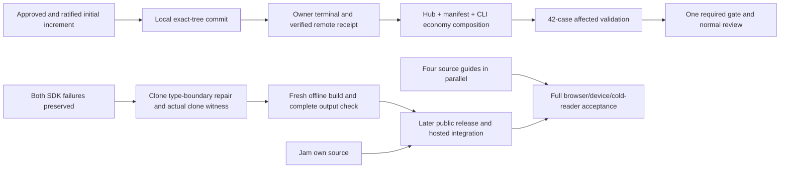

# Hourly sprint survey — 10 October 2026, 05:07 Eastern

Filed after the 09:07 UTC boundary. Messages and the actual workroom commitments were refreshed; facts remain attributed to their exact subjects.

The initial source increment is approved and ratified. Local main now has the exact approved tree. The workroom now marks the initial request satisfied and landed at sealed receipt `732ca210`. Owner reports original handle terminal 0 and one live remote query at08:23:26UTC matching the published head; the complete proof and sealed-receipt hashes are independently verified. The scanner repair passed its one real regression case and contract/bytes/client built and packed. The repaired attempt then stopped at derive emission with TS2304 for structuredClone. Builder has a narrow type-boundary repair; complete checker and public SDK acceptance remain unrun. Test reduction remains the highest priority, with Jam and documentation advancing alongside it.

| Work | Confirmed result | Next step / owner |
|---|---|---|
| Initial publication | All 229 artifacts filed; checker approved the complete increment and builder ratified it. Local main `a1277d9c` has approved tree `7f9bf06`. Filing ended successfully in 4,218.247 elapsed seconds; CPU was not captured. | Recorded receipt `732ca210` satisfies the bounded initial-publication request. Local main and cached `origin/main` now both name `a1277d9c`; owner terminal 0 and one live remote query are retained in verified proofbaf4b1fa. No unchanged gate. |
| Test economy | Latest repaired full gate: 1,005 Vitest passes, two original optional skips, eight Node passes; 96.61 elapsed / 155.00 CPU seconds. The 10× and complete edit-to-review goals remain unmet. | Continue reductions by useful invariant and actual avoided work; preserve native behavior, deadlines and meaningful recovery/authority witnesses. |
| Hub + manifest | Hub successor `ee7d2131` and manifest cleanup `bdf64bdd` have completed bounded source preparation. Manifest removes two redundant positive verifier calls and one unreachable conditional arm; corruption, origin and freshness coverage remain. | Builder prepares one exact combined subject now that the receipt is recorded: necessary compiler closure once, then cache 1 + Demo 5 + manifest 21 plus CLI real-Git 15, totaling 42 cases: 41 active and the original optional recorder skip. Old 27-case preparation is accepted as inert history, not executed. The successor has its own promise and includes only the three reviewed donors. Source/recipe rebinding, meaningful controls, one required gate and normal review remain. |
| CLI real Git | Read-only audit retains all 15 cases for distinct custody, SHA1/SHA256, moving-ref, refusal and exact size/count invariants. It identifies repeated real Git subprocess work. | Fixture-only source `92dc` removes 28 identity-setup commands statically while preserving fresh repositories and all 15 cases; its authoring is satisfied, runtime unrun. It joins the new 42-case economy subject to avoid a separate gate. Production batch reading is a separate unadopted opportunity. No measured savings yet. |
| Public SDK | Original 5e1 attempt failed before compiler; repaired c4bd attempt 92357 also terminated1 after reader 1 PASS and three package compile/pack successes. Derive resolution 0 / emit 2 produced actual TS2304 at fixtures.ts209. Completechecker/all three strict contexts were never dispatched. Outer 2.38 elapsed/2.64 CPU; reader0.15/0.15 and producer 1.61/2.05 are separate phase costs. | Planning decision `5bdb4183` adopts module-local, type-only structuredClone(DeclaredDefinition) support after complete diagnosis review. Builder has acknowledged the earlier producer-only preference; this implementation/decision mismatch is being reconciled before final Source is frozen. Preserve native clone semantics, public testing export, ambient/manifest/lock/compiler boundaries, both failed stages and no unchanged rerun. Strengthen existing compiled-output journey with actual variant/original-data preservation. No new validation result yet. Preserve the failed stage and logs. No unchanged rerun, public version, publication or deployment. |
| Jam | Existing own-module symbolic case at `a89bcf46` passed once: body 0.18 elapsed / 0.20 CPU, outer 0.43 / 0.34. Own source development has started under builder's readiness judgment. | Preserve original music; complete native key coherence, verified fact/genesis/time/provenance, public SDK and hosting integration, actual musical/listening and cold-outsider acceptance. A symbolic pass is not native proof. |
| Documentation | Four guides plus ledger/index are filed at exact6f91ee28, six-doc reviewbafd5f8d is claimed. All samples remain unrun; Source/test/config/dependency/assets are unchanged and the docs-only gate exemption applies. | Builder uses actual receiving source and independent exact-page review. Retain all 67 pages, 21 extra families and eight full-manual conditions. Source guides can progress beside Jam; public/hosted/cold-reader acceptance remains separate. |
| Planning and names | Existing common-head artifacts for plans 017/018 match both original frozen attachments and current main exactly. Fresh evidence-only joint review `d9544843` is approved and ratified; original planning delivery `5c716` is satisfied. Shared-name review16946 is satisfied; planning directionc134 is adopted with three required C4 corrections. Allocation/corrected-handoff taskb567 is claimed; R7/D7/M6 remain proposed/unreserved. | Recovered historical canonical review `693660` qualifies prior complete reading; its stale authority is not reused. Fresh current-subject proof supports the new evidence-only review. No runtime acceptance or old technical adoption. Builder preserves authorized shared names, repository-name separation, coherent versions and migration/device duties. Lock/unresolved-original/context eligibility before signing, whole known-answer journal-failure custody, and accepted/unverified vs verified record vs latest read must be explicit before browser commissioning. No code/runtime or slot reservation is adopted. |
| Worktree maintenance | Latest metadata survey:226 registered worktrees,118 nonprimary ancestor heads and116 clean. No path is cleared merely by those counts. This is an expanded ownership-review set, not proof of disposability. | Builder removes genuinely unneeded trees after checking owner, uncommitted work and retained dependency/evidence use. Preserve active branches and the three cross-checkout cache roots. No deletion occurred in this survey. |

Across the three measured gates `2a`, `c03` and `b7ee`, total elapsed time was 506.04 seconds; their test phases took 488.58 seconds, about 96.55% of those gates. This is not the percentage of all project time today or a controlled speedup. Manifest/demo account for about 35% of overlapping aggregate file durations. Filing and landing coordination are separate costs. The reported 70-minute filing already exceeds test runtime substantially; the read-only filing-cost audit identified candidates but authorized no gitseq implementation or benchmark.

All source/runtime claims stay at their actual subjects. The repaired initial gate transfers to its note-only final candidate by executable/config/test/dependency/asset equality, not a new run. Retired staging P2 provenance remains recorded and is explicitly reconciled in the formal review. SQL retention, cross-DO timeout-abort and media-type diagnostics remain retained; no physical-drain or universal-cause conclusion follows.

The original 5e1 failure has a generic public diagnostic; its exact exception remains inferred from the real quoted-data scanner defect. The repaired c4bd attempt has an actual structuredClone TS2304 diagnostic. The earlier31-file and later113-file public proofs match their respective hashes; no partial outputs or archives establish coordinated SDK success. Planner's premature whitelist-check wording was corrected after a field-name error; no execution was repeated. Local staged `0.1.0-dev.2` is not an adopted or reserved public version. Publisher identity/rights remain unresolved and do not block offline work.

Full B8/F1/C0/W1/U1, refined Counting/C1/M1/invitations, UX, complete browser/device continuity and real durable hosted coding remain open. Lease/fork/credential/command recovery, uncertain external effects, capacity/history/replay, actual enrollment/revocation, provider/audio and all manual/Jam acceptance retain their owners. No partial increment or green fixture completes them.

Verification limitation: planner's one read-only live remote query failed DNS resolution. Only local main and the cached `origin/main` ref were observed here; the sealed receipt is now recorded, while owner terminal/live remote proof is now captured and read. Planner ran no project runtime. No later SDK success or completed cleanup is inferred. Next hourly survey is due06:07 Eastern/10:07UTC; sprint preparation is due06:35Eastern/10:35UTC for the 07:00 boundary.

Cleanup disposition `e5a85764` is metadata preparation only: 226 registered, 118 ancestor heads, 116 clean, zero removals. It is not ratified as completed cleanup. Builder has been directed to resolve the eight actual owner/retention checks through gitseq and then perform authorized normal removals. Current planner reports no active physical dependency/process in its two historical sprint checkouts; ignored/private/evidence and inbound links still require checks.

Publication verified at 08:25 UTC: owner terminal assertion628f53, complete proofbaf4b1fa and sealed receipt732ca210; exact229 native/receipt/successor path sets match. Initial60e is satisfied and landed. Economy/docs/cleanup dependency released; full product acceptance remains open.

Latest SDK proof5f15b5b0 and all 113 explicit public files/304920B hashes are verified. The actual diagnostic and 18 child statuses are read; generated archives remain hash-only and failed emit outputs are partial. Module-local alternative proposal045ddb54 was read in full; adoption5bdb4183 and repair0da42 preserve originalclone behavior. Builder inbox was full, so a rejected addressed handoff was reposted in ordinary room chat; available tasks then refreshed and SDK/economy were claimed.

At the boundary: old 27 preparation4667 is satisfied at Source/inert scope after recipe/donor/hash review, with no execution. New42 successor e4c871d0 is claimedfcb08; three required compiler roots and actualCLI/Scope ownership are explicit. The latest SDK92357 attempt is terminal 1 with exactreader 1 PASS and checker never dispatched. Naming correction/allocation b567 is claimed0001cdb. Six-guide reviewbafd is claimed4b796; all samples remain unrun. No source update on main or new gate was recorded by this survey.
