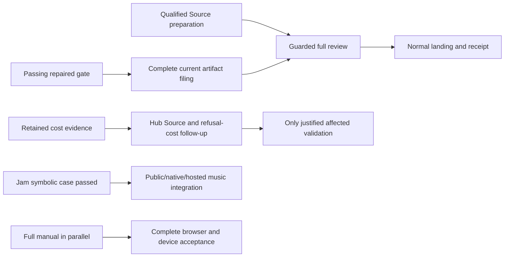

# Hourly sprint survey — 10 October 2026, 03:07 Eastern

Survey filed after the 07:07 UTC boundary. Planner read and acknowledged all six addressed messages (120–125), inspected the current primary and SDK Source report, and ran no project runtime.

The repaired initial candidate has a passing full gate and completed Source composition preparation. Checker now reports all 229 current artifacts present. The filing owner has not yet supplied a terminal outcome; inherited retired-finding provenance still needs reconciliation before the guarded whole-Source verdict and normal landing. Test cost improved substantially, but the complete 10× target remains unmet.

| Work | Verified outcome | Next action / owner |
|---|---|---|
| Initial delivery | `0e5954ec`, 229 paths: 201 authored text and 28 opaque. Only the note differs from passing `b7ee8549`; metadata and ordering match Git. | Current primary `23eaef7b` is effective but stale through retired P2 provenance. Checker independently reports 229 unique current artifacts and no missing paths. Builder preserves handle `99684`, confirms its actual terminal, and binds normal review. Old `bc2` filing `87954` is complete history, not current approval. |
| Current review | Checker report `4406deba` reconciles the whole receiving-main composition and finds no new integration blocker. Staging P2 retirement `911890e4` applies only to the repaired candidate. | Whole-Source preparation is not a verdict. Validate stale-basis qualifications of the targeted repair report without rewriting facts or adding checks. Main remains unlanded. |
| Test economy | Repaired normal gate passed 1,005 enabled Vitest cases, two original skips and all eight Node companions, in 96.61 elapsed / 155.00 CPU seconds. Retained file caches put manifest-tree/demo at about 35% of aggregate duration. | Keep the 10× and complete workflow targets open. Source audit identifies duplicate positive verification and unreachable private branches, with explicit surviving witnesses; origin/commit association and corruption coverage remain. |
| Hub optimization | Source `c8d98930` delivered; authoring and independent preparation are satisfied. Shared owned-pack cache preserves wire/refs/auth behavior and the old OwnGit case. | P3: Hub now copies/hashes necessarily refused data before codec limits. Choose a bounded refusal-order-preserving Source follow-up before expensive validation. One Scope compiler and six whole-file cases are the planned affected cohort, not yet executed. |
| Jam | Own-module check at `a89bcf46` passed its existing single symbolic case; scope `715c3fdc` is satisfied. Body 0.18 elapsed / 0.20 CPU seconds; outer 0.43 / 0.34. | Preserve original tunes/rhythm and made-up-reference qualification. Native key coherence, verified fact/genesis/time/provenance, public SDK, hosting and real musical/listening acceptance remain owed. No repeat for acknowledgment. |
| Public SDK | Reviewed r2 handoff is delivered. Producer-only Source report `cb7b6c0e` is delivered at clean pushed `5e1f7c50`, five authored paths. All execution is explicitly unrun; publication authority is still unverified. | Review the isolated four-package ESM/type producer/checker Source and its owned-input/compiler ancestry decisions. No compilation, registry publication, deployment or version reservation follows from source authorization. npm-owner information question remains pending. |
| Filing overhead | Read-only report `61939e74` is satisfied at its bounded scope. Source candidates are same-head projection reuse and repeated canonical-commit validation. Installed dirty binary/source binding remains unknown. | No gitseq changes or new benchmarks authorized. Preserve current process and all 229 path/order/signature/lease/authority/recovery obligations; an actual owner must bind source/build before improvement. |
| Full project | Manual, Counting/capacity/invitations, shared names, browser/device continuity and real durable hosted coding remain incomplete. Worktree retention review protects active evidence and three cross-checkout cache roots. | Manual reconciliation `e4ac50da` retains all 67 pages, 21 extra families and eight acceptance conditions; bounded manuscripts can proceed. Keep useful invariant coverage, actual authority and full product acceptance. Jam/docs and credential-free producer Source can proceed beside the highest-priority cost work. |

All timing comparisons are observed at their actual heads and loads. Aggregate per-file durations overlap and are not wall time; CPU-active filing is not test runtime. Raw SQL, cross-DO abort and media-type diagnostics remain retained. No universal cause, physical drain, published release, cold-user journey, Source approval or tenfold result is inferred.

No current Source/check work requires a publishing decision from Hugh. Actual publisher identity and rights are needed before external publication; that question does not block producer Source authoring. The documentation-lead advisory is deferred until after current filing/landing, preserving the frozen reviewed candidate.

Evidence is bounded to the stated checks, reports and message observations. This hourly report records progress; it does not replace Git publication, formal review or acceptance.
