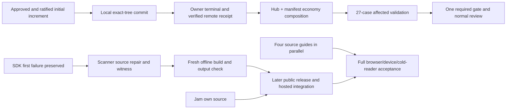

# Hourly sprint survey — 10 October 2026, 04:07 Eastern

Filed after the 08:07 UTC boundary. Workroom messages and durable landing state were refreshed; local main and cached remote ref were read again at 08:07 UTC.

The initial source increment is approved and ratified. Local main now has the exact approved tree. The original landing process still needs its terminal outcome and verified remote receipt. The first offline SDK attempt exposed a real module-scanner defect before compilation; builder has claimed its repair. Test reduction remains the highest priority, with Jam and documentation advancing alongside it.

| Work | Confirmed result | Next step / owner |
|---|---|---|
| Initial publication | All 229 artifacts filed; checker approved the complete increment and builder ratified it. Local main `a1277d9c` has approved tree `7f9bf06`. Filing ended successfully in 4,218.247 elapsed seconds; CPU was not captured. | Builder preserves original landing handle `4918`, supplies its actual terminal, sealed receipt and live remote verification. Local `origin/main` is only a cached ref. |
| Test economy | Latest repaired full gate: 1,005 Vitest passes, two original optional skips, eight Node passes; 96.61 elapsed / 155.00 CPU seconds. The 10× and complete edit-to-review goals remain unmet. | Continue reductions by useful invariant and actual avoided work; preserve native behavior, deadlines and meaningful recovery/authority witnesses. |
| Hub + manifest | Hub successor `ee7d2131` and manifest cleanup `bdf64bdd` have completed bounded source preparation. Manifest removes two redundant positive verifier calls and one unreachable conditional arm; corruption, origin and freshness coverage remain. | Builder prepares one exact combined subject after the initial receipt: necessary compiler closure once, then cache 1 + Demo 5 + manifest 21, totaling 27 cases including the original optional recorder skip. Source/recipe rebinding, meaningful controls, one required gate and normal review remain. |
| CLI real Git | Read-only audit retains all 15 cases for distinct custody, SHA1/SHA256, moving-ref, refusal and exact size/count invariants. It identifies repeated real Git subprocess work. | Separate fixture-only request `2c8cdab8` targets removal of 28 identity-setup commands while preserving fresh repositories. Production batch reading is a separate unadopted opportunity. No measured savings yet. |
| Public SDK | One offline attempt at `5e1f7c50` stopped with exit 1. Preflight and four read-only Git children passed; compiler, pack and checker were never dispatched. Outer cost 0.68 elapsed / 0.49 CPU seconds. | Builder repairs shared module-reference recognition under `0c3828a0`, with one meaningful data/import/rewrite witness and independent review. Preserve the failed stage and logs. No unchanged rerun, public version, publication or deployment. |
| Jam | Existing own-module symbolic case at `a89bcf46` passed once: body 0.18 elapsed / 0.20 CPU, outer 0.43 / 0.34. Own source development has started under builder's readiness judgment. | Preserve original music; complete native key coherence, verified fact/genesis/time/provenance, public SDK and hosting integration, actual musical/listening and cold-outsider acceptance. A symbolic pass is not native proof. |
| Documentation | Four concrete guides—Reviewing, Landing, Roles and membership, Contribute—are commissioned under `f1ee3793`, with minimal ledger/index maintenance. All samples remain unrun. | Builder uses actual receiving source and independent exact-page review. Retain all 67 pages, 21 extra families and eight full-manual conditions. Source guides can progress beside Jam; public/hosted/cold-reader acceptance remains separate. |
| Planning and names | Existing common-head artifacts for plans 017/018 match both original frozen attachments and current main exactly. A fresh evidence-only joint review is claimed. Shared-room-name current-source decision is also claimed. | Checker uses ordinary binding and honest reading coverage; old unfiled prose does not prove prior native reading. Builder preserves authorized shared names, repository-name separation, coherent versions and migration/device duties. Neither task adopts unfinished runtime behavior. |
| Worktree maintenance | 225 registered worktrees; 118 nonprimary heads are ancestors of local main. This is an expanded ownership-review set, not proof of disposability. | Builder removes genuinely unneeded trees after checking owner, uncommitted work and retained dependency/evidence use. Preserve active branches and the three cross-checkout cache roots. No deletion occurred in this survey. |

Across the three measured gates `2a`, `c03` and `b7ee`, total elapsed time was 506.04 seconds; their test phases took 488.58 seconds, about 96.55% of those gates. This is not the percentage of all project time today or a controlled speedup. Manifest/demo account for about 35% of overlapping aggregate file durations. Filing and landing coordination are separate costs. The reported 70-minute filing already exceeds test runtime substantially; the read-only filing-cost audit identified candidates but authorized no gitseq implementation or benchmark.

All source/runtime claims stay at their actual subjects. The repaired initial gate transfers to its note-only final candidate by executable/config/test/dependency/asset equality, not a new run. Retired staging P2 provenance remains recorded and is explicitly reconciled in the formal review. SQL retention, cross-DO timeout-abort and media-type diagnostics remain retained; no physical-drain or universal-cause conclusion follows.

The SDK failure has a generic public diagnostic. Static source analysis proves false module references from quoted `from` data; its precise unlogged exception remains an inference. All 31 explicitly listed public files match their hashes. Planner's premature whitelist-check wording was corrected after a field-name error; no execution was repeated. Local staged `0.1.0-dev.2` is not an adopted or reserved public version. Publisher identity/rights remain unresolved and do not block offline work.

Full B8/F1/C0/W1/U1, refined Counting/C1/M1/invitations, UX, complete browser/device continuity and real durable hosted coding remain open. Lease/fork/credential/command recovery, uncertain external effects, capacity/history/replay, actual enrollment/revocation, provider/audio and all manual/Jam acceptance retain their owners. No partial increment or green fixture completes them.

Verification limitation: planner's one read-only live remote query failed DNS resolution. Only local main and the cached `origin/main` ref were observed here; builder's actual remote proof and sealed receipt are still required. Planner ran no project runtime. No new terminal or remote receipt was recorded at this boundary. Next survey is due at 05:07 Eastern / 09:07 UTC.
