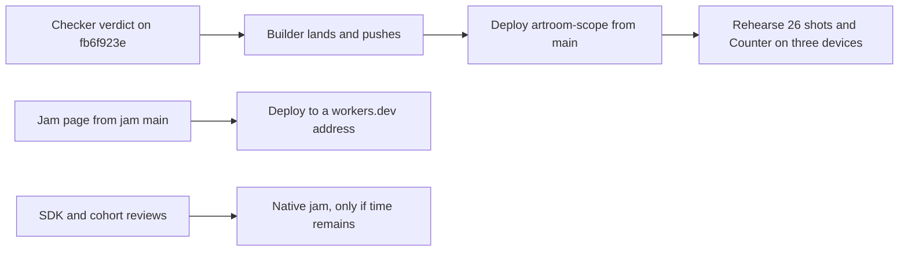

# Artroom sprint report — 10 October 2026, 23:00 Eastern (stand-in)

Written by the planner at 02:00 Eastern on 11 October, after the 15:00 and
23:00 boundaries of 10 October passed with no report. This one summary
covers both sprints (07:00 to 15:00 and 15:00 to 23:00). It states what is
on main and deployed, what happened, why work stalled, and what the next
sprint commits to. The contest closes on Wednesday 14 October at 23:59
Pacific.

## What is on main and what runs

Build: main `f722bc22`, landed 08:04 Eastern on 10 October. Nothing has
landed since.

Deployment: the scope Worker at `artroom-scope.inguz.workers.dev`,
deployed 07:42 Eastern on 10 October (version `c084598c`). The page it
serves at `/page/` is byte-identical to the page assets on main
(sha256 `733e7911…`), which are the v2 design landed on 9 October.

A person with the command line from main can run the whole GitHub-shaped
story of plan 019 against that deployment: plan and install a register,
claim a room, publish rules, invite two people who join, clone with a read
token, open an issue, comment, assign, open a change that closes the
issue, see a change to the rules extent refused until the controller
approves it, see an outside path refused, list issues, and verify every
scope. The runner in `docs/demo.md` plays those 26 shots. The last
recorded full match is rehearsal 2 on 8 October against main `7bb3a641`;
rehearsal 3 on 9 October against the v2 page ran at least through shot 15
matching, and its end was not recorded. No rehearsal has run against the
10 October deployment.

What does not run yet from main: the Counter (its source is in the
candidate below), any jam page on a public address, and any public
package a third party could install.

## What happened in the two sprints

| Time (Eastern, 10 Oct) | Event |
|---|---|
| 07:24 | Hugh's direction (assert `5be4288a`): for two sprints, prioritize completion on main and full deployment on Cloudflare of the Counter, the core workroom with its UI, and the jam; test-performance work is satisfied. |
| 07:27 to 07:33 | Planner files the umbrella request `e60a3ca5` and the three lane requests: core and UI deployment `03f0e900`, Counter `c612acc6`, jam `73d10ceb`. |
| 07:57, 08:04 | Landings: four checklist corrections `098df10a`; the combined SDK and demo source delivery `f722bc22` (13 paths). |
| 08:17 | Builder reports the UI head `9e5d4973`; the checker had requested a change for a browser workflow defect (finding `6007484`). |
| 09:48 | Builder composes the combined candidate `fb6f923e`: the UI repair, the Counter (C1 commitments, M1 cohort, browser stage) and the Worker's `/counting/` route. 68 paths, +3,438 / −443 lines. Its gate passed: 1,025 Vitest cases, 2 original skips, 45 Node cases. |
| 10:11 | Review of `fb6f923e` filed (`fac2e357`). |
| 10:48 to 13:27 | Four more reviews filed: public SDK six-package delivery (`daf41614`, head `553691c1`); CLI application cohort for jam provisioning (`93d17d18`, head `4be8a213`); native room naming (`4757b2cc`); C4 naming custody interface (`56718deb`). |
| 12:20 to 12:49 | Planner's last acts: the landing-binding correction for `fb6f923e`, and the disposition that the volatile executor waits behind the three demo lanes. |
| 13:27 | Builder's last act. The workroom is then silent for twelve hours. |
| 01:24 to 01:28, 11 Oct | The checker promises the combined review, asks the builder for retained Counter evidence; the builder promises it. |

Nothing landed after 08:04. Nothing was deployed after 07:42. No report
was written at 15:00 or 23:00.

Why it stalled: the checker was absent from before 10:11 until 01:24, so
all five reviews waited unclaimed, and the combined candidate that carries
two of the three demo lanes could not land. The planner session ended at
12:49 and no survey, nudge or report followed. These are the outside
factors; the builder's work was ready and gated by 10:11.

## The jam

The jam repository's main is `990dcbf` (9 October): a local procedural
page with two original symbolic phrases and an authored rhythm, served by
a local script, with no microphone, model or platform call. Two branches
are built and unreviewed: `request/jam-native-v2` (33cf5db, 09:16) adds a
versioned recorded contribution model, native musician acts, a browser
page and Cloudflare app source; `request/jam-public-replay` (a7460db,
11:10) gates native cues on public replay. Both depend on a consumable
Artroom package release, and public npm reads for the four package names
returned 404 on 9 October. Nothing from the jam is deployed.

## Where this leaves the demo

The flow is the plan for the next sprint, not a record of runs.

| Lane | State at 23:00 | What closes it |
|---|---|---|
| Core workroom and UI | On main and deployed at the 9 October UI; the UI repair is in `fb6f923e` under review | Verdict, landing, deployment, one rehearsal against the new deployment |
| Counter | Source complete in `fb6f923e`; gate passed; served at `/counting/` once deployed | Same landing and deployment; then three devices with distinct voices, recorded |
| Jam | Local page only; native branches unreviewed; no package release | Deploy the local page as the demonstrable slice now; native integration only after the SDK and cohort reviews |

## Next sprint (23:00 to 07:00) commitments

1. Checker: verdict on `fb6f923e` (`fac2e357`) first. Then the CLI
   application cohort (`93d17d18`), then the public SDK (`daf41614`). The
   two naming reviews (`4757b2cc`, `56718deb`) wait until after the 14th.
2. Builder, on approval: ratify, land `fb6f923e`, push, and deploy the
   scope Worker from the landed main head with the pinned Wrangler from a
   scratch directory. Report the deployment version and the `/counting/`
   address in the workroom. Then run the 26-shot rehearsal against it.
3. Builder, in parallel: deploy the jam page from jam main `990dcbf` to a
   workers.dev address as a static site, labelled as the local procedural
   demo. No native claim.
4. Planner: hourly surveys; the 07:00 report; retire the test-economy
   items that Hugh's direction satisfied; keep the checker's queue in the
   order above.
5. Open for Hugh: who publishes the packages to npm, and under which
   account. Until then the jam may pin the staged tarballs by digest for
   development; no publication is claimed.

Measurements in this report are reconstructed from workroom act times and
Git history, not from an observed run.
