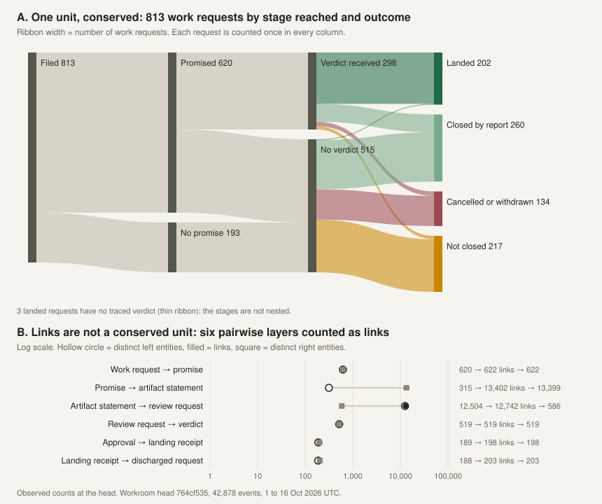
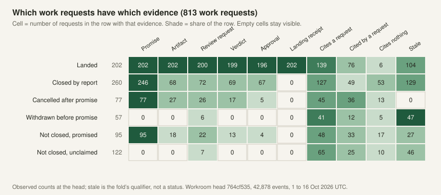
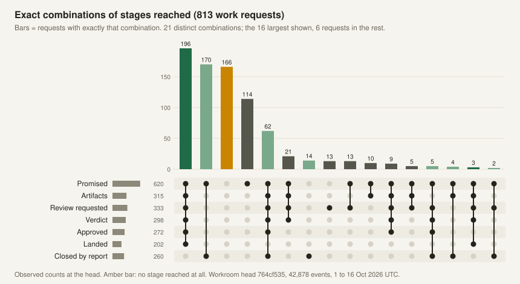
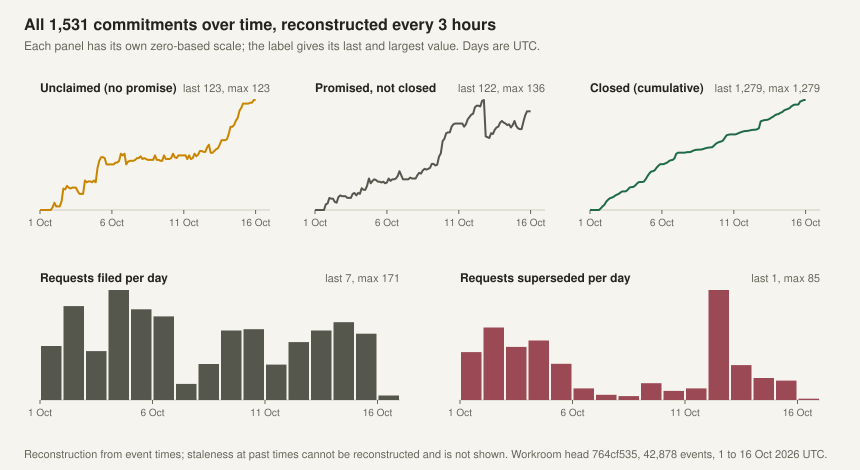
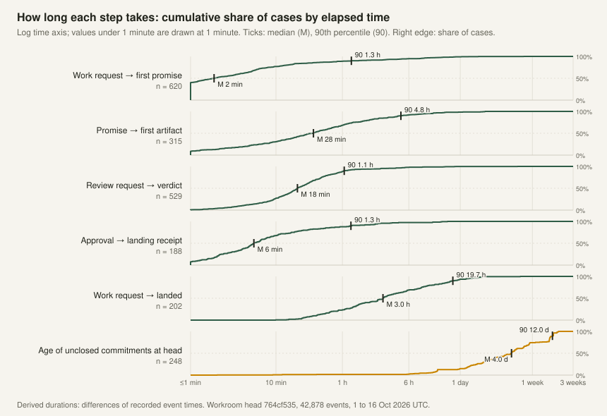
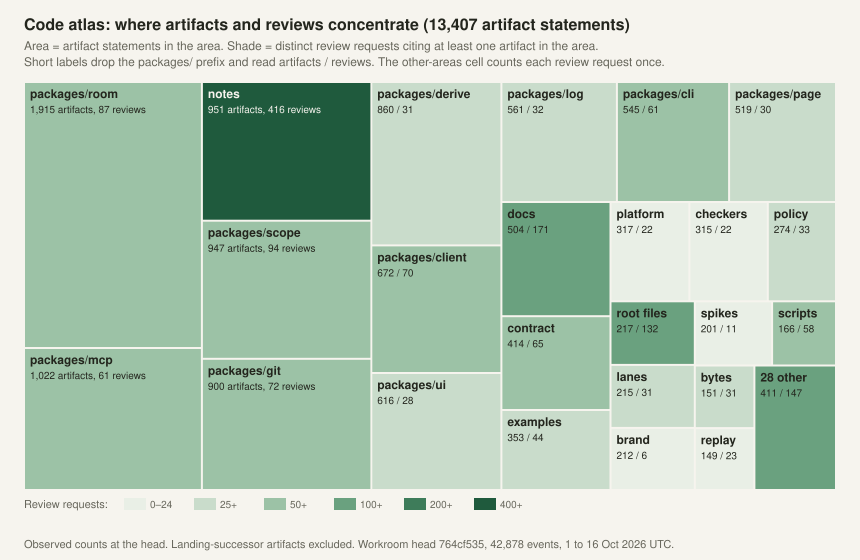
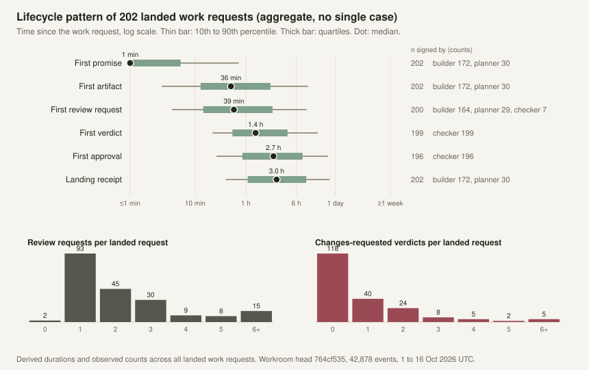
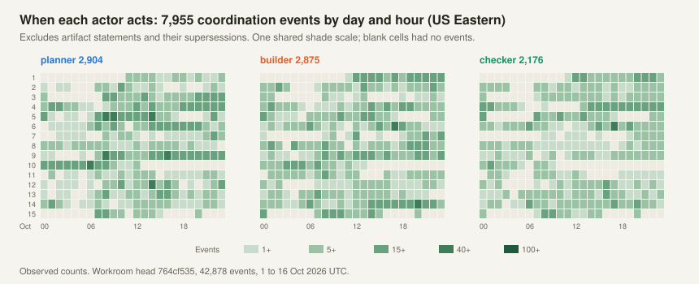

# A unified room interface: platform basis and design sequence

15 October 2026. Design baseline for independent review.

Request `a1889c73`, planner promise `39439c9d`.
Source inventory: main `40e37d8537aad5eecf8066fd426ae49842766526`.
This note replaces the earlier unlanded discussion draft of the same file
(request `f088256e`, branch `planner/forge-design-20261015` at `6f68b77c`).
Section 7 carries forward that draft's product shape, so the draft branch
can be retired.
It incorporates the forge research (`dbf2ccc4`) and navigation and
visualization research (`8ba14e34`).
Section 5 adds evidence and example charts from the project's own gitseq
workroom at event head `764cf535f5ffa5c4ff066acbe7f6238d973528fd`
(42,878 events, 1 to 16 October 2026 UTC).

The proposed result is a complete browser experience for coordinated
development, with the depth of a good forge and local Git client. The
design covers the platform prerequisites and the sequence for choosing
and validating views. Landing this note commissions no UI or runtime
implementation and changes no existing builder priorities.

## 1. A room should be understandable before its diagrams

For the current forge application, a room brings one repository's work
together: what people want to achieve, the content they propose, and the
decisions and outcomes that move the work forward. The room has members
and rules. Applications can add tools under those rules.

A person needs three familiar questions:

- **Work:** What are we trying to achieve, who undertook it, and what
  remains to be done?
- **Source:** Which files and exact versions are involved, and what changed?
- **Decisions and outcomes:** What needs attention, what is required, and
  what actually happened?

These are explanatory concepts, not a decision to add three navigation
tabs. Issues and Changes remain recognizable destinations. Repository
browsing and an attention view are candidates to test within the same
room shell. Rules and membership explain how work is governed. They do
not need to dominate ordinary work.

Hugh's main reference is Visual Studio Code: useful and deep, but complex
and sometimes difficult. Dap should preserve depth through the selected
work, rather than ask a person to understand the platform's internal
objects before finding a useful action.

Scope IDs, incarnations, definition pins, retained inputs, and read
frontiers remain available for inspection. Ordinary navigation explains
the relevant work and consequences in plain language. A global workbench
may gather several separately authorized rooms; it gains no authority
over them. Multiple repositories inside one current room are not assumed.

## 2. One connected investigation

Consider **Improve account recovery**. Its issue states an outcome and
conditions. A plan may split the work into concerns. People or agents
undertake parts and report contributions. A change proposes exact content.
Reviews and checks concern that version. Publication has its own outcome.
Future delivery tools could connect a published version to an environment.

A reviewer can follow the change back to the conditions, inspect its diff,
browse neighbouring code, and return to the same review. A maintainer can
start from a code area and find related work. An operator could start from
a running version and follow its evidence and purpose backward.

These are relationships, not one mandatory sequence. Several changes may
address an issue. One change may address several issues. Maintenance can
begin without an issue. A release can combine work from many changes.

Each fact has one canonical home. Other views summarize it and link to
its record. One interaction pattern applies throughout:

**Exact subject → current state → relevant requirements → available
action → recorded result.**

A diagram selects and explains work. It does not create a second workflow
or change an object's state merely because someone moves a visual mark.

## 3. What the current platform actually supplies

This inventory describes source at the baseline above. It does not claim
deployed availability or completed user acceptance.

| Area | Available foundation | Gap affecting the interface |
|---|---|---|
| Room | One fixed repository and branch, with membership, rules, and destination references in the [directory](../packages/platform/src/directory.ts) | Cross-room discovery and context are separate product work |
| Work | Native [issue](../apps/room/lanes/src/issue.ts) conditions, commitments, plans, concerns, reports, and requester judgments | Most deeper coordination remains outside the ordinary Page journey |
| Changes | [Manifests](../apps/room/lanes/src/change.ts) identify immutable proposal versions, reviews, jobs, and publication relationships | A retained one-file proposal and a Git-tree proposal have different source representations |
| Native reads | [Scope API](../packages/contract/src/transport.ts) exposes summary, final-item pages, history, entries, duties, logs, and retained inputs | No generic public relationship enumeration, room search, or arbitrary aggregate query |
| Counts and storage | Summary has exact type/state counts; [SQLite](../packages/scope/src/sqlite.ts) has state and immutable-key indexes, plus internal bounded metadata helpers | Filtered cross-scope totals, relationship indexes, and public query integration remain owed |
| Read authority | Existing sessions and signed reads enforce eligibility | [Recent-signer eligibility](../packages/scope/src/signed-reads.ts) can still scan history; an internal metadata seek alone does not make an authenticated query bounded |
| Page | [Room shell](../apps/room/page/src/main.ts), issue/change lists, contextual forms, focus restoration, and exact review safeguards | Lists materialize lanes before filtering; no shared graph/tree/diff navigation context |
| Client recovery | Specialized join/Start custody, context-bound drafts, and settlement interfaces exist | Ordinary Page actions and retained edits do not yet have complete durable reload recovery |
| Git | [Reader](../packages/git/src/reader.ts) verifies bounded objects, trees, refs, and ordered parents; isolated and [edit-base](../packages/git/src/edit-base.ts) retrieval helpers exist | No general authenticated history, tree, diff, search, or blame projection; partial helpers have not switched production callers |
| Published content | [Site routes](../packages/scope/src/site/route.ts) serve receipt-authorized immutable publications, directories, Markdown, and downloads | Publication access is not permission to browse arbitrary repository objects or unpublished work |
| Checks and effects | Jobs name exact subjects and configurations; Git publication has owned attempts, receipts, and unknown-outcome handling | The [checker runner](../packages/checkers/src/service.ts) has no production adapter; general automation and deployment management remain separate contracts |
| Applications | Declared application scopes, generic act discovery, and configured inventory exist | Complete installable packages, shared projections, and isolated presentations are the [approved destination](2026-10-15-self-contained-applications.md), not implemented capabilities |

The current [Page data layer](../apps/room/page/src/data.ts) rejects
incomplete or mixed-head enumeration, but can discard useful partial
results. It also conflates failed text reads with absent text. Richer
views must resolve these distinctions rather than inherit ambiguous data.

The [current routes](../apps/room/page/src/shell.ts) do not encode a full
room/version/path/comparison context. Existing per-tab preferences and
review safeguards are useful foundations, not the shared navigation
contract specified below.

## 4. Eight required platform contracts

These are capability requirements, not new implementations or claims
that one universal graph API already exists. Each needs an exact schema,
authority boundary, bounded behavior, and distinguishing witnesses before
a product increment depends on it.

### 4.1 Identity and navigation context

Every displayed subject resolves to a room, full scope reference where
applicable, item/opening fact, definition or application semantic identity,
revision, and observed head. Content adds the selected proposal version,
repository, resolved commit, path, or comparison endpoints.

A route records the nonsecret context needed to reopen the investigation.
Back and Forward restore selection, filters, expanded groups, and return
position. Reload preserves the documented subset. Actor and membership
context bind drafts and pending actions internally; credentials never
become route parameters.

Changing a view, selecting a historical commit, or opening a related item
must not silently switch a checkout, workspace, review subject, or draft.
A moving ref is resolved explicitly. Its later advancement is shown,
rather than substituted into retained review evidence.

### 4.2 Records and typed relationships with provenance

Use the existing native [item identity and state](../packages/contract/src/read.ts)
as the foundation. Add bounded projections for references and explicit
relationships, including final records. A relationship identifies both
subjects, its type and state, exact source fact, interpretation version,
and delivery or observation coverage where relevant.

The initial semantic inventory must distinguish:

- Accepted commitment under exact terms from assignment or an offer.
- Concern in a sealed plan from an arbitrary related issue.
- Reported contribution from requester acceptance of that report.
- A manifest's selected accepted reports from a simple closing link.
- Review or check evidence for one version from evidence about another.
- Requested publication from confirmed publication and its closing update.
- Changed-file membership from code dependency or inferred product impact.

There is no automatic business completion percentage or critical path.
Such measures require an adopted criterion and supporting facts.
Derived relationships state their derivation and remain distinguishable
from recorded ones. A copied relationship is not proof that every related
scope has advanced to the same state.

### 4.3 Bounded authorized lookup, search, and aggregation

Specify direct object lookup, supported filters and ordering, typed
neighbourhood expansion, timelines, scoped search, and named aggregates.
Requests have row, byte, traversal, work, and duration bounds. Results
identify source heads, continuation, index coverage, and completion.

Authority applies before returning rows, existence, or counts. Query
eligibility and any legacy index backfill must themselves be bounded.
An unauthorized reader must not learn migration state or restricted
subjects from an aggregate. No endpoint may scan every lane behind a
small visible result and claim bounded work.

Every aggregate declares its unit, population, grouping, deduplication,
time or head selection, and contributing-record query. Native exact
type/state counts can be reused where their meaning suffices. A matrix
cell or ribbon must open the exact records that contributed to it.

The existing priority-1 bottleneck task `e0292346` owns bounded-read
foundations. This broader product contract does not silently extend its
promise to all cross-room search and graph queries.

### 4.4 Coherent captured views, refresh, and coverage

A room is several histories. A combined view names the heads it observed
and its required cross-scope coverage. It does not claim one atomic room
snapshot merely because several responses arrived together.

Opaque query continuation binds the selection, sort, authorization
context, and head/frontier policy. Drift either restarts explicitly or
continues under a specified retained snapshot. Refresh invalidates or
updates affected projections while preserving the user's investigation.
Live subscription support is a separate declared capability; polling
does not acquire stronger consistency by being frequent.

The user must be able to distinguish complete absence from not loaded,
stale, denied, unsupported, redacted, and unavailable. Disclosure-safe
partial results may remain useful. They cannot justify an orphan-work
claim, an empty search conclusion, or a completion percentage without
the necessary coverage.

Record availability and archive cutoffs belong in this contract. Git
publication does not imply a complete room archive. Portable records and
credential-safe history remain separate durability work; this note
authorizes no export or change to its privacy rules.

### 4.5 Versioned source exploration and comparison

Specify authenticated member repository exploration independently of
anonymous published Pages. The supported journey is commit selection,
parents or changed files, full tree, file content, and comparison, with
one preserved context. A one-file retained proposal remains a valid
content subject even before it has a published integration commit/tree.

Required reads include commit metadata and ordered parent identities,
bounded directory children with exact path bytes/modes/object IDs, file
availability, changed-file summaries, and explicitly defined diffs.
History pages retain traversal frontiers and distinguish an unloaded
parent from a root. Search and blame each need their own scope,
completeness, cost, and interpretation contracts.

Comparison specifies exact endpoints and whether it compares snapshots
or changes since a selected merge base. Rename inference, binary content,
submodules, LFS, huge lines, omitted hunks, and unsupported formats have
explicit states. Metadata, summaries, and expensive content are separate
reads. Object verification, selected-path coverage, complete closure,
host retention, and publication eligibility remain different assertions.

### 4.6 Decisions, offered actions, and durable request custody

The shared client binds an action to the actual subject, selected version,
definition, and authority context. It explains relevant requirements and
rechecks current eligibility. An offered action can still be refused by
its eventual judgment; a job label grants no authority.

Keep the exact signed request and confirmed answer through reload under
the reviewed custody model. Lost replies remain unknown until settled.
Navigation must not create a new request, discard an unresolved mutation,
or treat retry as a fresh action without a deliberate choice.

Request accepted, evidence recorded, publication confirmed, and a future
deployment completed are separate facts. A derived readiness display
does not replace native judgment. A requirements cell opens evidence or
the appropriate contextual form; it is not a directly editable truth.

This contract overlaps the planned shared developer interface and current
client work. Its implementation needs explicit scope and a separate
commission, rather than another client built inside each visualization.

### 4.7 Application projections and a trusted host shell

Follow the adopted [self-contained application direction](2026-10-15-self-contained-applications.md).
Semantic, presentation, and release identities stay distinct. Browser,
MCP, and agents consume the same supported projections. A presentation
must not reinterpret an old event using a new semantic version.

The host owns identity, signing, custody, navigation, and the presentation
boundary. Untrusted application code does not receive the member's keys
or unrestricted room authority. Until the approved isolation prerequisite
exists, trusted operator presentations and generic host-rendered records
remain the available boundary.

An application can provide descriptions and reviewed semantic adapters
for its records and relationships. Unknown types retain a readable generic
home and honest capability limits. They do not acquire invented meanings
such as goal fulfillment, dependency, or deployment health. The generic
browser cannot execute package code merely to draw a graph.

### 4.8 Execution evidence and external outcomes

Native jobs bind a manifest, tree, configuration, check name, and deadline.
Result admission checks the signer against the lane-held rules and records
the actual checker. Requested inputs, applicable authority, and the
recorded performer therefore remain separate facts, including across
rules updates. General execution still needs a runner and result-custody
contract. Admission rules, event-triggered work, and provider operations
retain their different authority and recovery semantics.

Future deployment records need exact artifact/configuration, environment,
promotion authority, provider attempt, observed outcome, and health
observation identity/freshness. A passed historic check is not current
production health. A rollback is another authorized operation, not an
erasure of history or automatic reversal of storage changes.

These capabilities can join the same record and navigation model when
implemented. Their absence must not block useful issue/change/source
journeys, or be concealed by static success badges. The older
[repository-to-live-site plan](../plans/020-2026-10-05-repository-to-live-site.md)
is intent, not delivered deployment management.

## 5. Derive view priorities from questions and reliable facts

The following sequence is a design dependency order. It is not a new
P0/P1 queue or an implementation promise. Existing NOW and SOON tasks,
including priority-1 durability and bottlenecks, retain their priority.

| Design increment | User result | Necessary basis | Candidate presentation |
|---|---|---|---|
| Orientation and continuation | Find work, understand its state, open related records, and return | Identity, bounded discovery, record semantics, coverage, shared context | Existing lists, search/facets, canonical detail, attention projection |
| A complete everyday journey | Follow purpose → change → content → requirements → decision → confirmed outcome | Exact source/evidence, relationship provenance, durable actions | Connected tree/history/diff, requirements table, focused relationship trace |
| Large-scale explanation | Find uncovered goals, overlapping changes, and concentrated work | Exact relationship/aggregate contracts and useful grouping | Sankey/parallel sets, incidence/coverage matrices, code atlas |
| Execution and operational explanation | Follow validation or a running version to its inputs, decisions, and effects | Actual execution/deployment contracts | Event sequences, swimlanes, environment comparisons |

Prototype exploration can proceed with clearly labelled synthetic fixtures
while platform contracts are designed. A product capability cannot be
declared delivered from such a prototype.

### First visualization comparisons

Sankey is an early research candidate for the large-scale explanation
increment, connecting goals, issues, commitments, changes, and code areas.
Direct lists remain the comparison baseline. Its first comparison uses
separate pairwise incidence layers, with named relationship counts and
distinct entity counts alongside them. A connected layout must disclose
unequal incoming/outgoing totals, duplicate entities, and attribution
limits. Only recorded tuples justify an attributed end-to-end path.
Ten issues producing twenty commitments and
touching thirty files are not one conserved quantity. Pairwise links
through a change establish an association, not automatic file attribution
to every linked goal.

Compare that overview with a goal/evidence coverage matrix and direct
lists on the task **Find work missing implementation or evidence**.
Include unlinked and unclaimed work. It must not disappear because it
has no ribbon. Time-expanded alluvial views answer cohort movement and
reopening questions separately from static traceability.

For **Investigate concurrent changes in a subsystem**, compare a stable
code hierarchy/atlas and change-by-file matrix. File overlap is not proof
of a text conflict; extent overlap is another relation again. An UpSet
view becomes useful when exact multiway intersections are the question.

For **Explain why this version is blocked or running**, compare a focused
provenance trace, requirements table, and event timeline. Typed edges
explain actual dependencies or evidence. Git railway edges retain their
ancestry meaning. Temporal order alone does not establish causality.

More elaborate bundling, compound graphs, and spatial maps are later
research options. Elevate one when the simpler comparison demonstrably
fails a representative question, not because it can display more marks.

### Evidence from the project's own workroom

This project coordinates its own work in a gitseq workroom. Its workflow
has the same shape as the forge workflow: a request, a promise, artifacts
at an exact Git head, a review request, a verdict, ratification, and a
landing receipt, with supersession and staleness along the way. It has no
goal or issue layer, and it is not a room. Its numbers test the candidate
views above; they do not describe a forge.

**How the data was taken.** One read-only export of ref
`refs/seq/589bca982736a2361d15d53f7572375ef2f7aaf3` at event head
`764cf535`: 42,878 events from 1 October 15:53 to 16 October 00:52 UTC.
The exporter called gitseq's own verification and fold (gitseq `5876d211`,
read-only snapshot), kept relational fields only, and wrote no statement
text. Scripts computed every number and drew every chart. The exporter,
data and scripts stay outside the repository. Labels: an *observed* count
comes from the fold at the head; a *derived* duration is a difference of
recorded event times; a *reconstruction* estimates a past state from event
times and the current fold. Three keys sign events: planner (also the
operator), builder and checker. Hugh's own acts are not separable from
the planner's. The rules behind each number are in "How the numbers were
taken" at the end of this subsection.

Terms. A *work request* is addressed to the builder or planner (813
effective). A *review request* is addressed to the checker (716). The fold
projects each request as a *commitment*. A commitment *closes* when it is
satisfied, cancelled (superseded after a promise) or withdrawn (superseded
before one). *Stale* means a basis was retired; it qualifies a status and
does not replace it.

| Event class (observed) | Events | Share | Main signers |
|---|---:|---:|---|
| Supersession of an artifact | 16,442 | 38% | builder |
| Artifact statement (one path at one head) | 13,407 | 31% | builder |
| Artifact statement after a landing | 5,074 | 12% | builder |
| Assertion, proposal, roster | 2,806 | 7% | planner, builder, checker |
| Request; promise | 1,540; 1,308 | 7% | planner, builder; checker, builder |
| Ratification; review verdict; other report | 732; 539; 411 | 4% | all; checker; all |
| Supersession of a request; landing receipt | 399; 198 | 1% | planner, builder; builder |

The table omits 22 other supersessions. Artifact pointers and their
supersessions are 81% of all events. The builder signs 82%. A raw event timeline or ribbon layer would therefore
draw bookkeeping, not decisions. Views need a declared unit, and the
artifact layer must aggregate to a path or head.

*Figure 1. Panel A: a Sankey with one unit, the work request, counted once
per column (observed). Panel B: the same chain counted as links per
pairwise layer, on a log scale.* Panel A conserves flow only because it
draws one unit and a fixed attributed tuple per request; even so, 3 landed
requests have no traced verdict. Panel B shows why links cannot share one
ribbon width: 315 promises carry 13,402 artifact links, which feed 586
review requests, which yield 519 verdicts. This supports the note's
pairwise-layer rule with named link and entity counts. It undermines any
chained Sankey whose width changes meaning between layers. Panel A is
good at showing where requests end and bad at attribution across layers.

*Figure 2. Coverage matrix for **Find work missing implementation or
evidence**: outcome group × recorded evidence, observed at the head.* Zero
cells stay visible, so the 122 unclaimed and 95 promised but unclosed
requests remain on screen; 77 of the 95 have no artifact. It shows sets
well and paths badly. Stale cuts across five of the six rows, including
104 landed requests, so stale must be a column or filter, not a lane.

*Figure 3. UpSet view of the exact combination of stages each work
request reached (observed).* There are 21 distinct combinations. The
third largest, 166 requests, reached none of the seven stages; most
are unclaimed, stale or withdrawn. 34 requests have a review request but
no artifact under their promise, and 69 have a verdict but closed by
report. The stages are not a nested funnel, which a
funnel or single-status display would hide. UpSet earns its place when
exact multiway membership is the question, as the note says. It is bad
at order and time.

*Figure 4. Small multiples of all 1,531 commitments every 3 hours
(reconstruction), with requests filed and superseded per day (observed).*
Closed work rises steadily to about 1,280, while unclaimed work grows
from none to 123 and promised work to about 120. Supersession of requests
comes in bursts, with 85 on 12 October. Separate zero-based panels keep the
small open counts readable beside the large closed count. A time-expanded
alluvial view would suit the supersede and reopen movement, but staleness
at past times cannot be reconstructed from the current fold, so this
corpus cannot honestly drive a stale-state alluvial. That needs a
relationship contract with historical state (section 4.4). The panels are
good at trend and bad at naming the items behind it.

*Figure 5. Cumulative distributions of six intervals on a log time axis,
with median and 90th percentile marked (derived). Values under 1 minute
are drawn at the first tick, labelled ≤1 min.*

| Interval (derived) | n | Median | 90th percentile | Max |
|---|---:|---:|---:|---:|
| Work request → first promise | 620 | 2 min | 1.3 h | 133 h |
| Promise → first artifact | 315 | 28 min | 4.8 h | 47 h |
| Review request → verdict | 529 | 18 min | 1.1 h | 113 h |
| Approval → landing receipt | 188 | 6 min | 1.3 h | 17 h |
| Work request → landed | 202 | 3.0 h | 19.7 h | 121 h |
| Age of unclosed commitments at the head | 248 | 4.0 days | 12.0 days | 14.3 days |

Moving work is fast; the residue is old. A linear time axis hides one or
the other. Duration and timeline views need a labelled log scale, or
separate views for flow and for residue. Distributions show tails well
but do not say which items are slow; each tail needs a link to its list.

Review rounds are matrix-shaped. Each review request received at most one
verdict; a new round is a new review request at a new head. Of 202 landed
requests, 93 needed one review request, 45 needed two, 30 three, 32
four or more (maximum 16), and 2 had none traced. 118 landed with no
changes requested; 20 had three or more. In first rounds, 146 of 298
verdicts requested changes. 179 review requests were cancelled after a
changes-requested verdict, so "cancelled" alone misstates what happened.

*Figure 6. Code atlas: treemap of 13,407 artifact statements by area
(2,044 distinct paths, 52 areas), shaded by the distinct review requests
citing each area (observed). The cell for the 28 smallest areas counts
each review request once (147), not a sum over its areas.* `packages/room` has the most artifacts (1,915) but 87
review requests; `notes` has 951 artifacts and 416 review requests, 174
with changes requested. Activity is not one quantity: an atlas must name
its metric. 336 of 590 artifact-backed review requests span more than one
area, which supports a change-by-area matrix. The treemap is good for
proportion and bad for stable position; a code hierarchy keeps positions.

*Figure 7. Lifecycle pattern for **Explain why this version is blocked or
running**, aggregated over all 202 landed work requests: time from the
request to the first event of each stage (10th to 90th percentile,
quartiles, median; derived), who signs that event, as counts for every
signer (observed), and the
review rounds per request (observed).* No single case is shown. The
median request gets its first promise in about a minute, its first
artifact in 36 minutes, a first verdict in 1.4 hours, and lands in 3.0
hours. The builder promised 85% of landed requests; the planner promised
the rest, which were addressed to it. The pattern gives the context for one case;
it does not explain any case. That still needs a focused provenance trace
of real records under the reader's authority. Such a trace must expand on
demand: the largest landing receipt here is cited by 1,545 later events.

*Figure 8. Coordination events (excluding artifact statements and their
supersessions) by day and hour, one heatmap per actor (observed, US
Eastern).* Each actor acts in all 24 hours; 7 October is the quietest day.
A blank cell means no recorded event in that hour; it is not proof of
idle time or a handoff gap. The view is cheap, but it answers no question
in section 5. It should not take priority.

**Attention and residue.** Re-applying the status view's lane rules at
the head gives these rows (observed):

| Actor | Rows listed | Waiting on actor | Available to claim | Actor waits | Status stale | Cancelled, still listed |
|---|---:|---:|---:|---:|---:|---:|
| Planner | 314 | 41 | 53 | 29 | 43 | 147 |
| Builder | 407 | 65 | 64 | 20 | 28 | 229 |
| Checker | 318 | 0 | 0 | 69 | 19 | 230 |

One reneged row each for planner and builder is not in a column.
Cancelled commitments are 47% to 72% of the listed rows. Work requests
also form a graph, not a tree: 443 of 813 cite another work request, 118
cite more than one, and chains reach depth 10. 296 neither cite nor are cited by another request. 616 of
1,531 commitments carry the stale qualifier, 531 of them closed. These
are the items that must not disappear for lack of a ribbon; lists and
matrices must show them first.

**What the evidence implies for section 5.**

- Keep the pairwise-layer Sankey and its disclosures; reject a chained
  Sankey over links. Treat stage reach per request as a set question
  (matrix, UpSet), not a funnel.
- Put the coverage matrix and direct lists first for missing work. The
  unclaimed, unlinked and stale sets are hundreds of items here.
- Give time views log scales or split flow from residue.
- Give the code atlas a named metric and a stable hierarchy.
- Keep the provenance trace focused; high fan-in makes whole-graph
  drawing unreadable.
- Not supported by this corpus: a goal layer (none exists), file-level
  conflict or dependency (artifacts are path pointers; no diffs were
  exported), and Git railway views (ancestry is not in the workroom).

**Test tasks this corpus can serve.** As a realistic fixture, it suits two
tasks. First, **Find work missing implementation or evidence** over the
813 work requests. The answer sets are known by script: 122 unclaimed,
77 promised without artifacts, 3 landed without a traced verdict, and 296
unlinked. Compare direct lists, Figure 2 and Figure 1. Second, **Explain
why this request needed several review rounds** for any of the 32 landed
requests with four or more review requests. Compare a focused provenance
trace, a requirements table and an event timeline, each read against the
pattern in Figure 7. A prototype that passes on
this fixture is still a prototype, not delivered capability. The export
holds event IDs and paths but no text. Sharing it as a fixture needs the
review that section 4.4 requires; this note commissions none.

#### How the numbers were taken

*Populations.* All 42,878 events, including 39 the fold judged
non-effective, appear only in the event-class table. Of 1,540 request
statements, 1,529 are effective: 813 work requests (addressed to the
builder or planner) and 716 review requests (addressed to the checker).
The fold projects 1,531 commitment rows. They cover the same 1,529
requests: two requests have two rows each, one per promise. Totals over
all commitments count rows. Per-request figures use one row per request,
the last in fold order. Figures 1 to 3, the review rounds, Figure 7 and
the structure counts use work requests. Figure 4, the age row of Figure 5
and the attention table use all commitments.

*Closure.* A commitment is closed when the fold's status is satisfied,
cancelled or withdrawn. The fold's `terminal` field splits satisfied into
landed (203 rows; 202 work requests) and reported (682). The close time
is the landing receipt for landed work, the report for other satisfied
work, and the earliest effective supersession of the request for
cancelled or withdrawn work. Every closed row has a close time.

*Stages and traversal.* Stages follow recorded rests-on links one hop at
a time: request ← promise ← artifact ← review request ← verdict. Promised
means an effective promise rests on the request. Artifacts are statements
resting directly on such a promise; artifacts that rest on a landing
receipt are excluded. A review request counts for a work request when it
rests on one of those artifacts or directly on the request. Review
requests are deduplicated per work request as a set. 26 review requests
cite artifacts of two work requests and count for both; 63 reach no work
request. A verdict is a report with a `verdict` field resting on a review
request; each review request has at most one. This includes six builder
self-review verdicts of "complete". Approved means at least one traced
verdict is "approved". Landed and closed-by-report come from the fold.
Stages are separate flags, not a sequence. Figure 1B restricts layers 1
to 4 to work requests. Layer 5 covers all 198 landing receipts, using
each receipt's recorded approval. Layer 6 covers every commitment that
names a landing receipt.

*Durations.* A duration is a difference of recorded event times, so it is
derived. Quantiles use a nearest-index rule, not the ceil(n × q) nearest
rank, and do not interpolate. The value is the one at 0-based sorted
index round(q × (n − 1)). The rounding sends an exact half to the even
integer. So for an even n, the median is whichever middle value has the
even index. The rows of Figure 5 are as follows:

- Request to first promise: the earliest promise, for 620 work requests
  with one.
- Promise to first artifact: the earliest directly resting artifact, for
  each of 315 promises with one.
- Review request to verdict: the single verdict of each of 529 review
  requests that have one.
- Approval to landing receipt: 188 receipts that name an approval; 10
  receipts that name none are excluded.
- Request to landed: 202 landed work requests, ending at the receipt.
- Age: all 248 unclosed commitments, measured to the last event at the
  head.

Figure 7 measures each stage from the request to that stage's first
event, across landed work requests. Stages a request never reached are
left out, so n is 196 to 202.

*Observed and reconstructed.* Counts of statuses, the stale qualifier,
verdicts, links, areas and events are observed at the head. The state
series in Figure 4 is reconstructed every 3 hours from 1 October 00:00
UTC. The last sample, at 16 October 00:00 UTC, falls before the head,
so it shows 1,279 closed against 1,283. The rule is: closed if the close
time has passed; otherwise promised if the promise time has passed;
otherwise unclaimed. The fold reports staleness, performer and waiting
party only at the head, so no figure shows them at past times. The
attention table re-applies the status view's lane rules at the head. In
those rules, cancelled rows are not terminal and so stay listed. Figure 8
counts coordination events in US Eastern daylight time (UTC−4).

*Code areas.* An area is the first two path segments under `packages/`,
`apps/` or `plans/`, otherwise the first segment; single-segment paths
are "root files". A review request counts once per area it cites. The
cell for the smaller areas counts distinct review requests across those
areas.

## 6. Consistency, simplicity, and accessibility are acceptance conditions

Selection carries the same authorized record set between views. A selected
ribbon, matrix cell, directory, or event opens its literal contributors.
The active room, version, relation types, filters, metric, and coverage
remain inspectable. Grouping and layout changes are explicit; live updates
must not continually rearrange a person's investigation.

Known targets can start from search. Discovery can start from an overview.
Focused expansion and a simple relationship-column browser can support
the same journey without requiring graph interpretation. Opening an edge
explains the relationship; opening a node opens its canonical home.

Use the existing [brand guidance](../brand/GUIDELINES.md),
[tokens](../brand/tokens.css), and actual Page components. The earlier
[027 review](../plans/027-artroom-usability/v2/design-review.md) remains
useful for one-home-per-fact, exact-subject, and decision-point principles.
Its violet visual specification has been overtaken by the current brand.
This note does not select a new frontend framework or replace the shell.

Mobile uses deliberate full-width destinations and reliable Back, rather
than compressed desktop panes. Keyboard and screen-reader users need
equivalent structured relationships and direct record links. Selection
cannot depend on hover, colour, precise edge tapping, or dragging.
Retain visible focus, useful touch targets, zoom/reflow, and reduced motion.

Simple vocabulary does not mean one universal status. A promise can be
fulfilled, a check can pass, and publication can remain unknown. Show
those meanings at the relevant home, with a compact summary elsewhere.

## 7. Product shape carried from the discussion draft

The earlier discussion draft described the product; sections 1 to 6
describe the platform it needs. This section keeps what the draft argued
and those sections do not already state. It is input to the design work
in section 8, not a feature selection, and commissions no implementation.

### 7.1 Where each fact lives

Section 2 gives each fact one canonical home. The last two rows are
candidate extensions under section 4.8, not current capabilities.

| Record | What it owns |
|---|---|
| Issue and related work | Purpose, conditions, discussion, undertakings, plans, concerns, and reports |
| Change version | Exact proposed content, base, and selected contributions |
| Review or check | A judgment or execution result about an exact subject under stated requirements |
| Publication | An intended repository update, its attempt, and its confirmed or unresolved outcome |
| Possible deployment | Environment, artifact, promotion decision, provider operation, and outcome |
| Possible observation | Evidence about an environment or release at a stated time |

### 7.2 Three ways into the same work

Three entry points can share the canonical record pages and the
navigation context of section 4.1. Each carries a different risk.

| Entry point | Question it answers | Main difficulty | Depends on |
|---|---|---|---|
| Personal workbench | What needs me now? Promises made, reviews requested, decisions needed, failures, and operations awaiting confirmation | Attention must be explainable: assignment, unread activity, an obligation, and permission to act mean different things. The workbench must not become a second source of work state | 4.3 across rooms; 4.6; no added authority (section 1) |
| Issue or goal | Is the desired outcome on its way, and what supports it? | Density: an issue with several parallel changes must stay readable, and maintenance must stay possible without inventing an issue | 4.2; 4.4 |
| Repository or environment | What is this source or running version, what did automation do, and which work produced it? | Fragmentation: separate code, issue, automation, and deployment destinations make people rebuild context at every step | 4.5; 4.8 |

The draft preferred to combine the three around shared records, and to
test the primary journeys before choosing a default landing page or
navigation labels. Section 8's first prototype starts from an issue.

### 7.3 The capability map remains open

These areas define what to assess, not a release checklist. Section 3
says which have foundations; section 5 orders the design.

| Area | Capabilities to assess |
|---|---|
| Arrival and continuation | Room and repository discovery, switching, personal attention, and unfinished work |
| Coordination | Issues, conditions, commitments, plans, concerns, reports, and related changes |
| Source | Refs, commit railway, commit detail, full trees, file history, search, blame, and stable links |
| Comparison and review | Explicit endpoints, changed files, unified and split diffs, discussions, version comparison, requirements, and judgments |
| Validation and automation | Triggers, jobs, execution attempts, logs, evidence, artifacts, and qualifying results |
| Delivery | Builds, previews, release artifacts, environments, promotion, rollback, and observed health |
| Administration | Participants, effective authority, rules, integrations, synchronization, and recovery |

Browser editing and runnable development are separate scope choices. A
browser that reads a hosted branch has no checkout, index, terminal, or
build environment; GitHub documents the same separation for its
[browser editor](https://docs.github.com/en/codespaces/the-githubdev-web-based-editor).
This note selects neither.

### 7.4 Automation has three responsibilities

Moving work now done by Git hooks and GitHub Actions workflows into dap
needs the three contracts that section 4.8 names:

- **Guards** (section 4.8's admission rules) decide whether an act takes
  effect, using only evidence available at that decision.
- **Triggered work** follows an act that has taken effect, and may
  request a job or send a native message. It cannot reverse the act, just
  as a Git `post-receive` hook cannot undo what `pre-receive` accepted
  ([Git hooks](https://git-scm.com/docs/githooks)).
- **External operations** change something at a provider. Their outcome
  must be established independently of the request.

Triggers can be collaboration facts as well as Git events: a commitment
accepted, a report accepted, a version proposed, a review requested, a
check completed, or a publication confirmed. Each automation names its
source fact, definition, authority, and exact inputs. A job record links
the request to the execution attempt, runner, configuration, logs,
artifact identities, and result. A runner could be a local agent, an
existing service, or a new hosted runtime; its evidence needs a trust
contract before it can satisfy a native requirement. The interface must
distinguish a new check run from recovery of the same unknown operation.
Cancelling a process does not undo a provider change already submitted.

**What exists today** (read from source at this branch's base, `1a596d50`):
native guards, messages that the receiving scope verifies before judging,
and timed rules for deadlines ([architecture](../docs/architecture.md)).
In the [change definition](../apps/room/lanes/src/change.ts),
`request-check` records a job that names the manifest, tree,
configuration, check name, and a 30-minute deadline, and sends nothing:
recording a job does not start a runner. The
[checker service](../packages/checkers/src/service.ts) defines the runner
interface but has no adapter for a real runner. General scheduling,
external operations for applications, and deployment effects remain
separate work.

### 7.5 Deployment uses the same record model

Sections 4.6 and 4.8 separate approval, deployment success, and health.
The draft added:

- On the current hosting provider, a code version captures code and
  configuration; stored data stays outside it. Rolling back code does not
  reverse a data migration. A rollback is a new authorized move to a
  compatible earlier version, and the failed deployment keeps its history.
- Contracts still needed beyond section 4.8: environment ownership,
  credentials, concurrency, cancellation, reconciliation with the
  provider, and rollback compatibility.
- Repository-backed [Pages](../docs/pages.md) publish files; they are not
  deployment management.

### 7.6 Depth stays approachable

Beyond the pattern in section 2 and the conditions in section 6:

- Show useful content first; keep advanced evidence behind disclosure.
- On desktop, compare linked panes that leave room for code. The
  surrounding interface reflows when enlarged, even where a code
  comparison keeps a two-dimensional layout.
- A Git graph also needs a readable commit list and parent navigation.
  The railway follows recorded parents: commit dates do not decide its
  shape, and a drawn track is not a permanent branch identity.
- Railway lines need no decorative branch colours. Garnet keeps its brand
  meaning of refusal and removal.

### 7.7 Questions still open

Sections 5 and 8 settle the draft's first-journey question. Still open:

1. How do room, repository, personal work, and environment contexts
   relate? Section 1 settles only that a workbench gains no authority.
2. Which hook responsibilities become guards, native messages, or
   executable jobs?
3. Which runners and external observations may supply evidence that
   satisfies a native requirement?
4. Does deployment management cover applications hosted through dap, dap
   itself, or both? Its task flows add promotion or rollback with revoked
   authority, missing evidence, or incompatible state.
5. Which operations must work entirely inside dap, and where is an
   explicit handoff to another tool acceptable?

For questions 2 and 3, the [GitHub import design](2026-10-15-github-repository-import.md)
treats an imported assignee as an external reference, not a native
promise. An imported passing check is not automatically native evidence.

## 8. Specific next steps and review gates

These are design deliverables to commission separately. Owners name roles;
this table does not create new builder promises. The requester assigns
named owners and a bounded initial scope when each follow-up is
commissioned. An unresolved owner means proposed work, not a commitment.

| Step | Owner | Concrete output | Ready for the next step when |
|---|---|---|---|
| Establish this baseline | Planner; independent checker | Reviewed room model, source inventory, eight contracts, and sequence in this note | Contradictions and unsupported current-capability claims are resolved |
| Specify the shared read model | Planner with platform/API owner; checker | Exact initial record/edge schemas, relation semantics, authority, bounds, continuation, coverage, and aggregate definitions | A forge fixture is queried without a hidden whole-room scan; an unfamiliar application retains a readable home, safe navigation, and provenance without invented forge semantics or package execution |
| Specify navigation and custody | Planner with client owner; checker | Route/selection schema, restoration and refresh rules, exact-subject action binding, durable request/answer behavior | Related-object investigation, reload, and a lost reply preserve subject and outcome meaning |
| Specify source exploration | Git/platform owner with planner; checker | Public member-read boundary, commit/tree/file/compare contracts and cost/completeness model | Same exact content can be reached from a change, history, or path, with unsupported cases explicit |
| Compare complete task flows | Planner/design owner; representative users | First the ordinary journey below, then the three specialized questions in section 5, on desktop and mobile with shared fixtures | A study names users, coverage, measures, and thresholds before implementation selection; observed results justify the initial feature boundary |
| Commission a vertical implementation | Planner/requester; builder; checker | Separate reviewed requests with exact dependencies and distinguishing witnesses | The first useful end-to-end increment has an agreed platform and UI contract |

The first prototype follows an ordinary room journey: resume an issue,
inspect its undertaking and related change, find the blocker, read the
exact content, return, and take an eligible action. Specialized diagrams
must improve an identified part of that journey or a named scale question.

Read-model and source-contract work can progress independently where their
dependencies allow. Design prototypes need not wait for every future
automation feature. Later implementation requests must distinguish reuse
of existing P1 work from genuinely additional scope.

The prototype fixture set includes multiple changes per issue, a change
linked to several issues, a replaced manifest, differing requirements,
closed/final records, a failed check superseded by a later run, an unknown
publication, an unsupported application, and incomplete reads. Source
fixtures include merges, filtered/missing history, large/binary content,
and branch movement during investigation.

Measure these results against the current interface:

- Can an unfamiliar technical user explain the room's work, source, and
  decisions without being taught scopes or storage internals?
- Can someone resume work, find its blocker and responsible party, and
  reach the relevant action? Record time, backtracking, and wrong turns.
- Can they identify the exact reviewed content and qualifying evidence,
  including when a newer version invalidates an earlier display?
- Does Back restore version, path, filters, selection, and return position
  after inspecting related code or work?
- Can they distinguish a recorded request from publication and deployment
  outcomes, including an unknown operation?
- Can they answer overlap and coverage questions without treating missing
  data as absence or association as causal implementation?

Wrong-subject actions, hidden incomplete coverage, and false-success
interpretations are critical failures regardless of comparative speed.
Back must restore the listed investigation context; reload must preserve
the subset explicitly agreed in the navigation contract. Test keyboard,
screen reader, touch,
enlarged text, zoom, and reduced motion. Decide task-success thresholds
before the comparative study; this note claims no completed usability test.

## 9. Research basis and scope of adoption

Research covered official GitHub/GitLab and local-client documentation,
native dap source, mobile navigation patterns, visualization research,
and accessibility guidance. It did not include hands-on comparative
product testing or a current live visual baseline.

Useful primary references support the proposed comparisons:

- [Tower historic trees](https://www.git-tower.com/help/guides/commit-history/historic-file-trees/mac)
  separates changed files from the complete tree at a commit.
- [GitLab comparison methods](https://docs.gitlab.com/user/project/repository/compare_revisions/)
  distinguishes snapshot and merge-base comparison intent.
- [D3 Sankey](https://github.com/d3/d3-sankey) defines numeric ribbon values
  and an acyclic layout; [Parallel Sets](https://eagereyes.org/publications/Kosara-TVCG-2006)
  addresses categorical distribution.
- [Node-link/matrix research](https://mohammad.ghoniem.info/research/ivs-usability-2005.pdf)
  supports task-dependent comparisons, not a universal graph-size cutoff.
- [Search, Show Context, Expand on Demand](https://dig.cmu.edu/publications/2009-doigraphs.html)
  provides a large-graph navigation approach.
- [UpSet](https://vdl.sci.utah.edu/publications/2014_infovis_upset/),
  [Software Cartography](https://scg.unibe.ch/research/softwarecartography),
  and [EventFlow](https://hcil.umd.edu/eventflow/) address intersections,
  spatial orientation, and temporal sequences respectively.
- [WAI tree interaction](https://www.w3.org/WAI/ARIA/apg/patterns/treeview/)
  and [reflow guidance](https://www.w3.org/WAI/WCAG22/Understanding/reflow.html)
  inform accessible file navigation and comparisons.

Approval adopts the room model, required-contract inventory, design
sequence, and follow-up gates as a planning baseline. It does not adopt
an exact API schema, a final chart/navigation set, an application trust
exception, a new archive policy, or an implementation commission.
